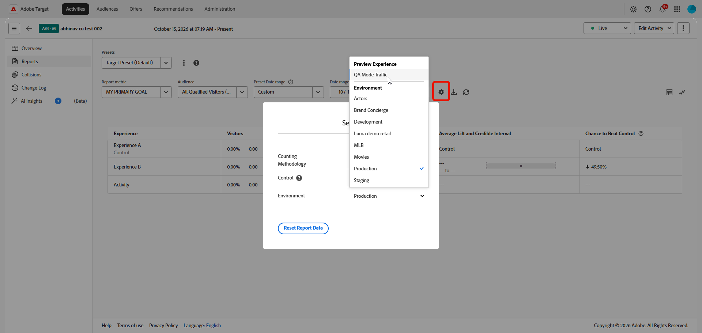

# 활동 QA 시작 {#activity-qa}

>[!BEGINSHADEBOX]

**이 페이지에서:** 활동 QA 링크를 사용하여 활동을 처음부터 끝까지 테스트하고, QA 보고를 검토하고, QA 모드에서 해제하는 방법을 알아봅니다.

>[!ENDSHADEBOX]

**[!UICONTROL 활동 QA]**&#x200B;을(를) 사용하면 [!DNL Adobe Target] 활동을 라이브로 시작하기 전에 완전히 테스트할 수 있으며, 변경되지 않는 미리 보기 링크, 선택적 대상 타기팅 및 라이브 활동 데이터와 별도로 유지되는 QA 보고를 사용합니다. **[!UICONTROL 활동 QA]** 기능에는 다음이 포함됩니다.

* **영구 링크:** 경험이나 활동에 대한 업데이트에 관계없이 변경되지 않고 다시 생성해야 하는 팀 구성원과 링크를 공유합니다.
* **선택적 대상 타깃팅:** 대상 조건을 충족하지 않고도 경험 모양을 확인하려면 타깃팅 기준을 테스트하거나 무시하십시오.
* **개별 QA 보고:** 지표가 예상대로 증가하는지 확인합니다. QA 보고서 데이터는 프로덕션 보고(비 A4T 보고의 경우)와 별도로 유지됩니다.
* **다른 활동과 함께 미리 보기:** 배달 기준(페이지/[!DNL Target] 요청/대상)을 충족하는 다른 라이브 활동과 별개로 경험을 미리 봅니다.
* **전체 사용자 여정:** QA 링크를 사용하여 한 번 사이트에 액세스한 다음 **[!UICONTROL 활동 QA]**&#x200B;에서 전체 사이트를 탐색합니다. 세션을 종료하거나 [QA 대상 북마클릿](/help/main/c-activities/c-activity-qa/activity-qa-bookmark.md)을 사용하여 강제로 나올 때까지 **[!UICONTROL 활동 QA]**&#x200B;에 남아 있습니다. 이 기능은 여러 웹 페이지에 걸친 활동이 있는 경우 유용합니다.

  >[!NOTE]
  >
  >이 기능은 버전 2.*x* 이상의 at.js 구현에 적용됩니다. at.js 1.*x* 구현의 경우, 이 기능은 방문자의 브라우저가 서드파티 쿠키를 차단하지 않는 경우에만 적용됩니다.

## QA URL 액세스 및 공유 {#section_1C59BAA247B247BDB125D1BE8EAD4547}

활동 QA 링크를 사용하면 사용자와 팀이 사이트에서 활동이 라이브로 전환되기 전에 각 활동 경험을 볼 수 있습니다. QA 트래픽은 라이브 트래픽과 별도로 보고되므로 테스트는 라이브 보고서에 영향을 주지 않습니다.

1. 활동의 **[!UICONTROL 개요]** 페이지에서 **[!UICONTROL 활동 QA]**&#x200B;를 클릭합니다.

   ![개요 페이지의 [활동 위치] 섹션에 있는 활동 QA 단추](../assets/activity-qa.png)

1. 테스터가 대상에 적합한지 여부를 선택하려면 **[!UICONTROL 대상 규칙을 일치시켜 경험을 봅니다]**. 대상 일치가 작동하는지 확인하려면 이 옵션을 켜고 활동의 모양과 느낌을 확인하려면 이 옵션을 끕니다.

   * **켜짐:** 테스터가 경험을 보려면 타깃팅 요구 사항을 충족해야 합니다. 경험 타깃팅(XT) 활동의 경우 단일 활동 URL이 제공되며 표시되는 경험은 자격이 있는 타깃팅 규칙에 따라 다릅니다.
   * **해제:** 링크는 자격 여부에 관계없이 경험을 표시합니다. QA 중에 언제든지 두 설정 간을 전환할 수 있습니다.

   

1. **[!UICONTROL 다른 모든 활동에 대한 기본 콘텐츠 표시]**&#x200B;를 설정하여 다른 라이브 활동이 페이지에 표시되는지 여부를 선택합니다.

   * **설정:** 다른 모든 활동에 대해 기본 콘텐츠가 표시됩니다. 동일한 페이지/[!DNL Target] 요청의 다른 라이브 활동을 고려하지 않고 미리 보기가 별도로 표시됩니다.
   * **해제:** 테스트 중인 활동과 다른 라이브 활동 간에 충돌이 있는 경우 [일반 우선 순위 규칙](/help/main/c-activities/priority.md#priority)이 적용되므로 QA하려는 활동이 표시되지 않을 수 있습니다. 표시된 활동에 대한 지표 증가가 QA 보고 환경에서만 발생합니다.

1. **[!UICONTROL 완료]**&#x200B;를 클릭하여 변경 내용을 저장합니다.

1. 테스트를 위해 조직의 구성원과 활동 링크 URL을 공유합니다.

   각 링크 URL(경험 A, 경험 B 등의 경우)은 해당 경험에서 사용자 여정을 시작합니다. 경험이 여러 페이지(템플릿 테스트 또는 다중 페이지 테스트)에 걸쳐 있는 경우에도 경험당 하나의 URL만 생성됩니다.

   링크는 만료되지 않으며, 활동 또는 경험을 변경할 때 다시 보낼 필요가 없습니다. 그러나 활동을 편집하는 대신 **[!UICONTROL 대상 라이브러리]**&#x200B;와 다른 대상을 적용하는 경우 다시 공유해야 하는 새 링크가 생성됩니다.

1. 경험의 URL을 클릭한 다음, 일반적으로 사이트를 탐색하여 여러 페이지(여러 페이지가 있는 경우)에서 경험을 봅니다.

   **[!UICONTROL 활동 QA]** 모드가 페이지 전체에서 유지되므로 사이트를 탐색하여 다른 페이지를 볼 수 있습니다. 버전 2.*x* 이상을 사용하는 at.js 구현의 경우 마찬가지입니다. at.js 1.*x* 구현의 경우, 이는 방문자의 브라우저가 서드파티 쿠키를 차단하지 않는 경우에만 적용됩니다.

1. 활동 링크 URL에서 생성된 보고서를 보려면 활동의 **[!UICONTROL 보고서]** 페이지에 액세스하고 **[!UICONTROL 설정]** 아이콘()을 클릭한 다음, **[!UICONTROL 환경]** 드롭다운 목록에서 **[!UICONTROL QA 모드 트래픽]**&#x200B;을 선택하십시오.

   보고서 설정의 환경 목록에 있는 

## 활동 QA 모드 종료

**[!UICONTROL 활동 QA]** 모드는 사용자가 종료할 때까지 유지됩니다. **[!UICONTROL 활동 QA]**&#x200B;에서 웹 사이트를 탐색한 후에는 [!DNL Target] 세션이 만료되거나 강제로 나올 때까지 QA 모드를 유지합니다. 일반 방문자처럼 사이트를 보려면 를 종료해야 합니다.

### at.js 2.*x*

사이트에 at.js 2.*x*&#x200B;이(가) 배포된 경우 [Target QA 북마클릿](/help/main/c-activities/c-activity-qa/activity-qa-bookmark.md)을 사용하여 **[!UICONTROL 활동 QA]**&#x200B;를 강제로 해제하십시오. 다음 섹션에 설명된 대로 빈 값으로 사이트의 페이지를 로드하면 at.js 2.*x*&#x200B;이(가) 배포될 때 브라우저에서 QA 쿠키를 *제거하지 않음*&#x200B;합니다.

### at.js 1.*x*

사이트에 at.js 1.*x*&#x200B;이(가) 배포된 경우 [Target QA 북마클릿](/help/main/c-activities/c-activity-qa/activity-qa-bookmark.md)을(를) 사용할 수 있을 뿐만 아니라 `at_preview_token` 매개 변수를 빈 값으로 설정하여 사이트에서 페이지를 로드하여 수동으로 나올 수 있습니다. 예:

`https://www.mysite.com/?at_preview_token=`

### [!DNL Adobe Experience Platform Web SDK]

사이트에 [[!UICONTROL Platform Web SDK]](https://experienceleague.adobe.com/docs/target-dev/developer/client-side/aep-web-sdk.html?lang=ko){target=_blank}이(가) 배포된 경우 `at_qa_mode` 매개 변수를 빈 값으로 설정하여 사이트에서 페이지를 로드하여 수동으로 나올 수 있습니다. 예:

`https://www.mysite.com/?at_qa_mode=`

## 고려 사항 {#section_B256EDD7BFEC4A6DA72A8A6ABD196D78}

### 가용성 및 제한 사항 {#availability}

+++ Automated Personalization experience preview URL

**[!UICONTROL 활동 QA]**&#x200B;은(는) 이제 모든 [!DNL Target] 활동 유형에 사용할 수 있으므로 &quot;경험 미리 보기 URL을 사용하여 Automated Personalization 활동 미리 보기&quot; 기능이 더 이상 필요하지 않습니다.

+++

+++ 보고 소스로서의 Analytics (A4T)

**[!UICONTROL 활동 QA]** URL은 [Analytics를 보고 소스로 사용](/help/main/c-integrating-target-with-mac/a4t/a4t.md)(A4T)하는 활동에서 사용할 수 있습니다. **[!UICONTROL 활동 QA]**&#x200B;를 사용하여 QA를 수행하는 동안 생성된 히트는 활동이 라이브로 전환된 후에도 활동 데이터가 흐르는 동일한 보고서 세트로 이동합니다.

+++

+++ 보관되거나 종료된 활동

**[!UICONTROL 활동 QA]**&#x200B;에 종료 날짜가 지난 보관된 활동이나 활동에 대한 콘텐츠가 표시되지 않습니다. 종료된 활동을 비활성화하는 경우 **[!UICONTROL 활동 QA]**&#x200B;가 작동하도록 활동을 다시 저장해야 합니다.

+++

+++ 가져온 활동

[!DNL Target Classic]에서 [!DNL Target Standard/Premium]&#x200B;(으)로 가져온 활동은 QA URL을 지원하지 않습니다.

+++

+++ 자동 할당 및 권장 사항 모델

**[!UICONTROL 자동 할당]** 및 **[!UICONTROL 권장 사항]** 활동에서 모델은 **[!UICONTROL 활동 QA]**&#x200B;에서 캡처한 방문의 영향을 받지 않습니다.

+++

### 링크 및 검색 {#links-and-browsing}

+++ &quot;URL은&quot; 상태인 활동

[양식 기반 작성기의 개선](/help/main/c-experiences/form-experience-composer.md) 또는 시각적 경험 작성기의 [페이지 전달 옵션](/help/main/c-experiences/c-visual-experience-composer/viztarget-options.md)에서 활동을 만드는 동안 &quot;URL은&quot;을 지정한 경우 **[!UICONTROL 활동 QA]**&#x200B;가 URL 매개 변수를 추가하므로 QA URL이 작동하지 않습니다. 이 문제를 해결하려면 QA URL을 클릭하여 사이트로 이동하고 추가된 매개 변수를 URL에서 제거한 다음, 새 URL을 로드하십시오.

+++

+++ 서드파티 쿠키를 차단하는 브라우저(at.js 1.*x*)

Safari를 사용하거나 서드파티 쿠키를 차단하는 다른 브라우저를 사용하는 경우 at.js 1.*x*&#x200B;이(가) 있는 경우 **[!UICONTROL 활동 QA]** 모드가 페이지 간에 지속되지 않습니다. 이러한 경우 탐색하는 각 URL에 미리보기 매개 변수를 추가해야 합니다. [CNAME](https://experienceleague.adobe.com/docs/target-dev/developer/implementation/implement-cname-support-in-target.html?lang=ko){target=_blank}을(를) 구현한 경우에도 마찬가지입니다.

+++

+++ 여러 경험 대상이 있는 활동

활동에서 여러 경험 대상을 사용하는 경우(예를 들어, 동일한 활동에 포함된 미국 및 영국 사이트), QA 링크가 4개의 조합(경험 A/미국 사이트, 경험 A/영국 사이트, 경험 B/미국 사이트, 경험 B/영국 사이트)에 대해 생성되지 않습니다. 두 개의 QA 링크(경험 A와 경험 B)만 만들어지며 사용자는 페이지를 볼 수 있는 적절한 대상자에 대한 자격을 충족해야 합니다. 영국 QA 사람은 미국 사이트를 볼 수 없습니다.

+++

+++ 다중 페이지 활동

**[!UICONTROL Target QA 모드]** UI는 다중 페이지 활동에서 경험의 첫 번째 URL만 표시합니다. 여정 테스트를 만들고 URL1에서 URL2로 이동한다고 가정합니다. 그러나 URL2로 독립적으로 이동하려면 URL1에 대해 제공된 모든 URL 매개 변수를 복사하여 &quot;?&quot;를 지정한 후 URL2에 적용합니다 URL1에 나와 있는 것처럼.

+++

### 로드되지 않는 링크 미리보기 {#preview-not-loading}

+++ 저장된 활동이 너무 많음

계정에 저장된 활동이 너무 많으면 저장된 활동에 대한 **[!UICONTROL 활동 QA]** 미리 보기 링크가 로드되지 않을 수 있습니다. 미리보기 링크를 다시 시도하십시오. 이 문제가 반복되지 않도록 하려면 더 이상 적극적으로 사용되지 않는 저장된 활동을 보관하십시오.

+++

+++ 이중 인코딩 미리보기 매개 변수

모든 `at_preview` 매개 변수와 값이 이미 URL로 인코딩되어 있습니다. 대부분의 경우 모든 것이 예상대로 작동합니다. 그러나 일부 고객은 쿼리 문자열 매개 변수를 다시 인코딩하려는 로드 밸런서나 웹 서버를 사용합니다.

이 이중 인코딩을 사용하면 [!DNL Target]에서 `at_preview_token`을(를) 디코딩하려 할 때 올바른 토큰 값을 추출할 수 없으므로 미리 보기가 작동하지 않습니다.

[!DNL Adobe]은(는) IT 팀에 얘기해서 모든 미리 보기 매개 변수가 허용 목록에추가된으로 설정되어 있는지 확인하여 이러한 값이 어떤 식으로든 변환되지 않도록 하는 것이 좋습니다.

다음 표에는 도메인에서 허용 목록에추가된으로 사용할 수 있는 매개 변수가 나와 있습니다.

| 매개 변수 | 유형 | 값 | 설명 |
|--- |--- |--- |--- |
| `at_preview_token` | 암호화된 문자열 | 필수, 기본값 없음 | QA 모드에서 실행할 수 있는 캠페인 ID 목록이 포함된 암호화된 엔티티입니다. |
| `at_preview_index` | 문자열 | Empty | 매개 변수의 형식은 `<campaignIndex>` 또는 `<campaignIndex>_< experienceIndex>` 두 색인이 모두 1로 시작합니다. |
| `at_preview_listed_activities_only` | 부울(true/false) | 기본값: false | &quot;true&quot;면 `at_preview_index` 매개 변수에 지정된 모든 캠페인이 처리됩니다. &quot;false&quot;이면 페이지의 모든 캠페인이 미리 보기 토큰에 지정되지 않았더라도 처리됩니다. |
| `at_preview_evaluate_as_true_audience_ids` | 문자열 | Empty | [!DNL Target] 요청 범위에서 항상(타깃팅 및 보고 수준에서) &quot;true&quot;로 평가되어야 하는 세그먼트 ID의 밑줄로 구분된(&quot;_&quot;) 목록입니다. |
| `_AT_Debug` | 문자열 | 창 또는 콘솔 | 콘솔 로깅 또는 새 창입니다. |
| `adobe_mc_ref` |  |  | 기본 페이지의 참조 URL을 새 페이지에 전달합니다. `AppMeasurement.js` 버전 2.1 이상에서 사용하는 경우 [!DNL Adobe Analytics]는 이 매개 변수값을 새 페이지의 참조 URL로 사용합니다. |
| `adobe_mc_sdid` |  |  | [!DNL Supplemental Data Id]&#x200B;(SDID) 및 [!DNL Experience Cloud Org Id]을(를) 기본 페이지에서 새 페이지로 전달합니다. 이 ID를 전달하면 [!UICONTROL Analytics for Target]&#x200B;(A4T)에서 기본 페이지의 [!DNL Target] 요청을 새 페이지의 [!DNL Analytics] 요청과 함께 &quot;결합&quot;할 수 있습니다. |

+++

## 대상 JavaScript 라이브러리 [!UICONTROL QA 모드] 호환성 {#compatibility}

[!DNL Target]은(는) 다음 JavaScript 라이브러리를 지원합니다.

* [at.js 1.x](https://experienceleague.adobe.com/docs/target-dev/developer/client-side/at-js-implementation/at-js/how-atjs-works.html?lang=ko)
* [at.js 2.x](https://experienceleague.adobe.com/docs/target-dev/developer/client-side/at-js-implementation/at-js/how-atjs-works.html?lang=ko)
* [Adobe Experience Platform 웹 SDK](https://experienceleague.adobe.com/docs/target-dev/developer/client-side/aep-web-sdk.html?lang=ko)

다음 표는 다양한 활동 유형을 나열하고 각 라이브러리에 대해 **[!UICONTROL 활동 QA]** 모드가 지원되는지 여부를 나타냅니다.

| 활동 유형 | at.js 1.x | at.js 2.x | Platform Web SDK |
| --- | --- | --- | --- |
| [!UICONTROL A/B 테스트] | 예 | 예 | 예 |
| [!UICONTROL 자동 할당] | 예 | 예 | 예 |
| [!UICONTROL 자동 타깃팅] | 예 | 예 | 예 |
| [!UICONTROL Automated Personalization] (AP) | 예 | 예 | 예 |
| [!UICONTROL 경험 타기팅] (XT) | 예 | 예 | 예 |
| [!UICONTROL 다변량 테스트] (MVT) | 예 | 예 | 예 |
| [!UICONTROL 추천] | 예 | 예 | 예 |
