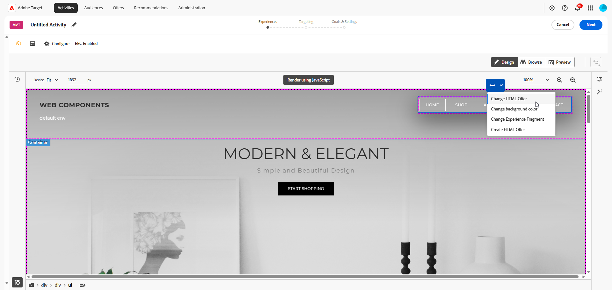

# 조합 만들기 {#create-combinations}

>[!BEGINSHADEBOX]

**이 페이지에서:** **[!UICONTROL 다변량 테스트]**&#x200B;의 조합을 구성하는 이미지 및 HTML 오퍼를 만드는 방법을 알아봅니다.

>[!ENDSHADEBOX]

**[!UICONTROL 다변량 테스트]**(MVT)에서 모든 위치에는 여러 개의 오퍼가 포함되어 있으며 각 위치의 오퍼 조합은 하나의 경험입니다. 테스트에 포함할 오퍼를 만들려면 [!DNL Adobe Target]의 **[!UICONTROL 시각적 경험 작성기]**(VEC)를 사용하십시오.

VEC를 사용하여 오퍼를 만들고 편집하는 방법에 대한 자세한 내용은 [시각적 경험 작성기 선택 사항을 참조하십시오.](/help/main/c-experiences/c-visual-experience-composer/viztarget-options.md)

>[!NOTE]
>
>원래 선택한 요소 외에 상위 요소를 선택할 페이지에서 개체를 선택할 때 **[!UICONTROL 선택 영역 확장]**&#x200B;을 클릭할 수 있습니다. 상위 요소를 선택하면 이 요소의 모든 하위 요소가 자동으로 선택됩니다. 선택 요소를 여러 번 확장할 수 있습니다.
>
>[DOM 경로](/help/main/c-experiences/c-visual-experience-composer/viztarget-options.md#dom-path)를 사용하여 요소를 탐색할 수도 있습니다.

## 이미지 오퍼 {#image-offers}

하나의 위치에서 여러 개의 이미지 오퍼를 테스트하여 가장 성공적인 이미지를 파악합니다.

1. 페이지에서 이미지를 클릭한 다음 **[!UICONTROL 이미지 오퍼 변경]**&#x200B;을 선택합니다.

   

1. **[!UICONTROL 이미지 오퍼]** 대화 상자에서 테스트에 포함할 모든 이미지를 선택한 다음 **[!UICONTROL 추가]**&#x200B;를 클릭합니다.

   

각 이미지가 해당 위치에서 별도의 경험이 됩니다.

## HTML 오퍼 {#html-offers}

하나의 위치에서 여러 개의 HTML 오퍼를 테스트하여 가장 성공적인 오퍼를 파악합니다.

1. 페이지에서 HTML 오퍼를 클릭한 다음 **[!UICONTROL HTML 오퍼 변경]**&#x200B;을 클릭합니다.

   

1. HTML 오퍼를 선택하고 **[!UICONTROL 오퍼 만들기]**&#x200B;를 클릭한 다음 **[!UICONTROL HTML 오퍼]**&#x200B;를 클릭합니다.

   

1. 오퍼 이름을 지정하고, HTML 오퍼에 대한 코드를 입력하거나 붙여 넣은 다음 **[!UICONTROL 만들기]**&#x200B;를 클릭합니다.

   포함하려는 추가 HTML 오퍼에 대해 이 작업을 반복합니다.

1. **[!UICONTROL 저장]**&#x200B;을 클릭합니다.

각 HTML 오퍼가 해당 위치에서 별도의 경험이 됩니다.

테스트를 시작하기 전에 포함할 조합 수와 조합 검토 방법에 대한 권장 사항은 [다변량 테스트 모범 사례](/help/main/c-activities/c-multivariate-testing/best-practices.md#create)를 참조하십시오.
