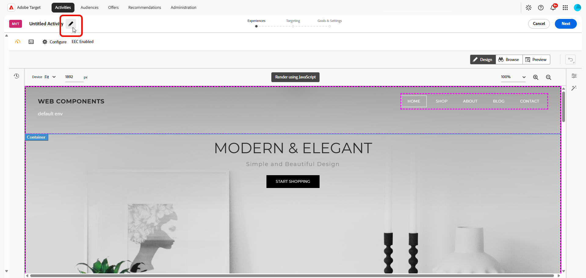

# 다변량 테스트 만들기 {#create-mvt}

>[!BEGINSHADEBOX]

**이 페이지에서:** **[!UICONTROL 시각적 경험 작성기]**(VEC)에서 **[!UICONTROL 다변량 테스트]**(MVT)를 만드는 방법을 알아봅니다. 활동을 만들고, 경험을 빌드하고, 검토하고, 타깃팅을 설정한 다음 목표와 설정을 구성합니다.

>[!ENDSHADEBOX]

[!DNL Adobe Target]의 **[!UICONTROL 시각적 경험 작성기]**(VEC)를 사용하면 **[!UICONTROL 다변량 테스트]**&#x200B;를 쉽게 만들고 [!DNL Target] 내에서 페이지의 부분을 수정할 수 있습니다.

[!DNL Target] 가리키고 클릭 편집기를 사용하여 원하는 위치를 선택하고 여러 오퍼를 추가할 수 있습니다.

**[!UICONTROL 다변량 테스트]**(MVT)는 페이지 우선 보고서를 사용합니다. 즉, 테스트가 해당 페이지에 대해 디자인한 경험을 사용하여 특정 URL에서 실행됩니다.

**[!UICONTROL 다변량 테스트]**(MVT)를 만들려면 아래 단계를 수행하십시오.

1. [활동 만들기](#create-activity)
1. [경험 구축 및 검토](#build-experiences)
1. [타깃팅 설정](#set-targeting)
1. [목표 및 설정 구성](#configure-goals-and-settings)

## 활동 만들기 {#create-activity}

활동 유형과 게재 유형을 선택하고, 테스트할 페이지를 지정하고, 활동의 이름을 지정합니다.

1. **[!UICONTROL 활동 만들기]** > **[!UICONTROL 다변량 테스트]**&#x200B;를 클릭합니다.

   [!DNL Target]에서 사용 가능한 다양한 활동 유형과 그 차이점에 대한 자세한 내용은 [활동](/help/main/c-activities/activities.md#concept_D317A95A1AB54674BA7AB65C7985BA03)을 참조하십시오. 필요한 활동 유형 세트를 결정하는 데 도움이 되는 [타겟 활동 유형](/help/main/c-activities/target-activities-guide.md)을 참조하십시오.

   

1. 배달 유형: **[!UICONTROL 웹]**, **[!UICONTROL 모바일]**, **[!UICONTROL 이메일]** 또는 **[!UICONTROL 기타/API]**&#x200B;을(를) 선택하십시오.

1. (조건부) [Target Premium](/help/main/c-intro/intro.md#premium) 고객인 경우 [작업 영역을 선택](/help/main/administrating-target/c-user-management/property-channel/property-channel.md)합니다.

1. 테스트할 페이지의 [URL을 지정](/help/main/c-activities/t-test-ab/t-test-create-ab/ab-activity-url.md#ab-activity-url)합니다. 시작 부분에 HTTP 또는 HTTPS를 포함하는 전체 URL을 사용합니다.

1. 그런 다음 **[!UICONTROL 만들기]**&#x200B;를 클릭합니다. **[!UICONTROL 시각적 경험 작성기]**&#x200B;가 열립니다.

1. 활동의 이름을 지정하려면 **[!UICONTROL 편집]** 아이콘()을 클릭하고 활동에 대한 수사적 이름을 지정한 다음 **[!UICONTROL 저장]**&#x200B;을 클릭합니다.

   {{activity-name-rules}}

   

## 경험 구축 및 검토 {#build-experiences}

각 위치에 오퍼를 추가하고, 결과 경험을 미리 보고, 테스트 계획이 실현 가능한지 확인하십시오.

1. [각 위치에 오퍼를 만듭니다](/help/main/c-activities/c-multivariate-testing/t-create-multivariate-test/add-offers.md#concept_DCE6B45C30F7419B8EC17AFDEE8D8AA6).

   다음과 같은 종류의 오퍼를 추가할 수 있습니다.

   * HTML
   * 이미지
   * 텍스트

1. **[!UICONTROL 미리 보기]**&#x200B;를 클릭하여 [환경을 미리 보기](/help/main/c-activities/c-multivariate-testing/t-create-multivariate-test/preview-experiences.md)하세요.

1. **[!UICONTROL 경험 표시]** 아이콘(  )을 클릭하여 왼쪽 프레임에 모든 경험 목록을 표시한 다음 목록에서 특정 경험을 클릭하여 해당 경험을 봅니다.

1. [트래픽 견적 도구를 사용하여](/help/main/c-activities/c-multivariate-testing/t-create-multivariate-test/traffic-estimator.md#task_71AA6922AFD447EA8C5E610A78ABA714) 테스트 계획의 가능성을 테스트합니다.

### 경험 제외 (선택 사항) {#exclude-experiences}

충돌하는 변형을 표시하는 경험이나 미적으로 균형 잡히지 않은 경험을 제외하도록 선택할 수 있습니다.

1. **[!UICONTROL 콘텐츠 관리]** 아이콘( )을 클릭하여 **[!UICONTROL 경험 관리]** 대화 상자를 표시합니다.

1. 한 경험을 제외하려면 해당 경험 옆에 있는 **[!UICONTROL 추가 작업]** 아이콘()을 클릭한 다음 **[!UICONTROL 제외]**&#x200B;를 클릭합니다.

1. 여러 경험을 제외하려면 원하는 경험에 대한 확인란을 선택한 다음 **[!UICONTROL 제외]**&#x200B;를 클릭합니다.

## 타깃팅 설정 {#set-targeting}

테스트를 시작할 방문자를 선택하고 테스트 요약을 검토합니다.

1. **[!UICONTROL 타깃팅]** 페이지에 액세스하려면 **[!UICONTROL 다음]**&#x200B;을 클릭하세요.

   흐름 다이어그램은 대상과 해당 트래픽 비율을 할당하고, 트래픽 할당 방법을 선택하고, 활동의 각 경험에 대한 트래픽 할당을 지정하는 단계를 안내합니다.

1. (조건부) **[!UICONTROL 모든 방문자]** 컨트롤을 클릭하여 활동에 대한 다른 대상을 선택합니다.

   **[!UICONTROL 모든 방문자]** 대상이 기본값으로 설정됩니다. 다른 대상을 선택하면 해당 이름이 가장 왼쪽 컨트롤에 표시됩니다. 예를 들어 항목 수를 모든 방문자의 50% 또는 &quot;캘리포니아인&quot; 대상자의 45%로 제한할 수 있습니다.

   +++ 다른 대상을 선택하는 절차

   오른쪽 프레임이 표시되어 대상을 추가 또는 삭제하고 활동에 대한 방문자 비율을 할당할 수 있습니다.

   1. 대상을 변경하려면 오른쪽 프레임에서 **[!UICONTROL 바꾸기]** 아이콘()을 클릭하십시오.
   1. **[!UICONTROL 대상 추가]** 대화 상자에서 [원하는 대상을 선택](/help/main/c-activities/t-test-ab/t-test-create-ab/ab-audience.md)한 다음 **[!UICONTROL 대상 할당]**&#x200B;을 클릭합니다.

      여러 대상을 결합하는 대상을 만들려면 **[!UICONTROL 대상 결합]**&#x200B;을 클릭합니다. 자세한 내용은 [여러 대상 결합](/help/main/c-target/combining-multiple-audiences.md)을 참조하십시오.

      **[!UICONTROL 대상 라이브러리]**&#x200B;에 없는 새 대상을 만들려면 **[!UICONTROL 대상 만들기]**&#x200B;를 클릭하십시오. [대상자 만들기 워크플로](/help/main/c-target/c-audiences/audiences.md)에서 다음 옵션 중 하나를 선택하십시오.

      * **[!UICONTROL 대상 라이브러리]**: **[!UICONTROL 대상 라이브러리]**&#x200B;에 저장되고 다른 활동에서 다시 사용할 수 있는 온디맨드 대상을 만듭니다.
      * **[!UICONTROL 이 활동만]**: **[!UICONTROL 대상 라이브러리]**&#x200B;에 저장되지 않고 현재 활동에서만 사용할 수 있는 [활동별 대상을 만듭니다](/help/main/c-target/creating-activity-only-audience.md).

   1. 오른쪽 프레임에서 **[!UICONTROL 방문자 비율]**&#x200B;을 클릭한 다음 활동을 시작할 자격 있는 방문자의 비율을 선택합니다.

   +++

1. [테스트 요약을 검토하고](/help/main/c-activities/c-multivariate-testing/t-create-multivariate-test/test-summary.md#reference_971AB225963A4DC18EEB5B0E20F0A4A7)원하는 대로 변경한 후 **[!UICONTROL 다음]**&#x200B;을 클릭합니다.

## 목표 및 설정 구성 {#configure-goals-and-settings}

**[!UICONTROL 목표 및 설정]** 페이지에서 [!DNL Target]에게 테스트 측정 방법을 알려 줍니다. 사용 가능한 설정은 [!DNL Target] 또는 [!DNL Analytics]을(를) 보고 소스로 사용하는지에 따라 다릅니다.

1. 페이지의 섹션을 검토하고 필요한 사항을 설정합니다. [목표 및 설정 페이지에서 설정한 내용](#goals-settings-overview)을 참조하세요.

   | 섹션 | 설정한 항목 |
   |---|---|
   | **[!UICONTROL 활동 설정]** | 선택적 목표인 **[!UICONTROL 우선 순위]**(여러 활동이 위치와 대상을 공유할 때 사용) 및 **[!UICONTROL 기간]**(시작 및 종료 날짜)입니다. |
   | **[!UICONTROL 보고 설정]** | 보고 소스, 목표 지표(예: **[!UICONTROL 전환]** 지표), 추가 지표 및 보고 대상. 목표 지표에 대한 고급 설정도 여기에서 사용할 수 있습니다. |
   | **[!UICONTROL 기타 메타데이터]** | 귀하 또는 다른 팀 멤버에게 유용한 활동에 대한 참고 사항입니다. |

1. 활동을 만들려면 **[!UICONTROL 저장 후 닫기]**&#x200B;를 클릭하십시오.

모든 옵션에 대한 자세한 내용은 [목표 및 설정](/help/main/c-activities/t-test-ab/t-test-create-ab/ab-goals-and-settings.md#ab-goals-and-settings)을 참조하세요.

## 교육 비디오: 다변량 테스트 만들기(9:25) 

이 비디오에서는 안내가 있는 [!DNL Target] 3단계 워크플로우를 사용하여 다변량 테스트를 계획하고 만드는 방법을 보여 줍니다.

* 다변량 테스트 정의 및 디자인
* 다변량 테스트 만들기

>[!VIDEO](https://video.tv.adobe.com/v/17395)
