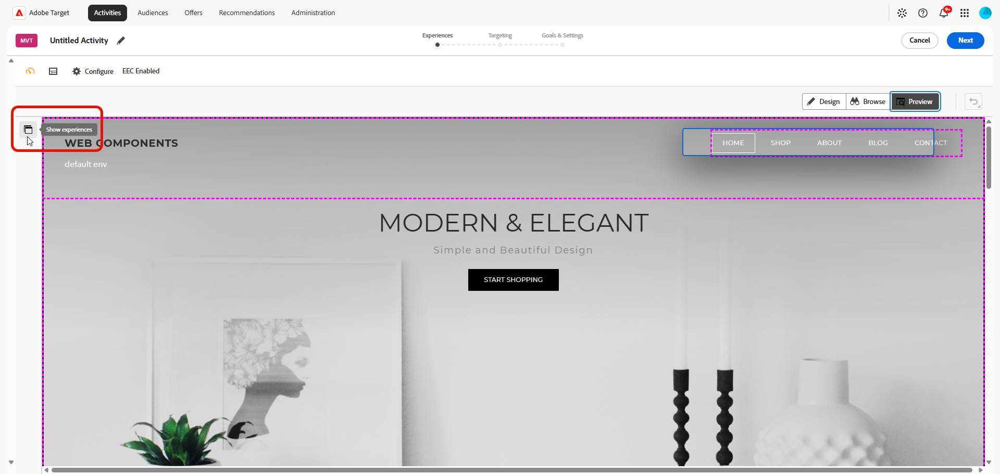

# [!UICONTROL 다변량 테스트]에 대한 경험 미리 보기 {#preview-mvt-experiences}

>[!BEGINSHADEBOX]

**이 페이지에서:** **[!UICONTROL 시각적 경험 작성기]**&#x200B;에서 **[!UICONTROL 다변량 테스트]**&#x200B;의 각 경험을 미리 보는 방법과 경험을 제외하거나 포함하는 방법을 알아봅니다.

>[!ENDSHADEBOX]

[!DNL Adobe Target]의 **[!UICONTROL 다변량 테스트]**(MVT)는 페이지의 여러 경험을 비교하므로 각 경험과 함께 페이지를 미리 보는 것이 좋습니다. 미리보기에는 테스트가 시작되기 전에 경험을 제외할지 여부를 결정할 수 있도록 오퍼가 각 경험에서 어떻게 결합되는지 보여 줍니다.

1. **[!UICONTROL 시각적 경험 작성기]**(VEC)에서 **[!UICONTROL 미리 보기]**&#x200B;를 클릭한 다음 **[!UICONTROL 경험 표시]** 아이콘()을 클릭하여 왼쪽 프레임에 모든 경험 목록을 표시합니다.

   

1. 목록에서 특정 경험을 클릭하여 해당 경험을 봅니다.

1. (선택 사항) 경험을 제외하거나 포함하려면 **[!UICONTROL 콘텐츠 관리]** 아이콘()을 클릭하여 **[!UICONTROL 콘텐츠 관리]** 대화 상자를 표시합니다.

1. 충돌하는 변형을 표시하는 경험이나 미적으로 균형 잡히지 않은 경험을 제외하도록 선택할 수 있습니다. 그런 다음 다음 다음 중 하나를 수행합니다.

   * 한 개의 경험을 제외하려면 해당 경험 옆에 있는 **[!UICONTROL 추가 작업]** 아이콘()을 클릭한 다음 **[!UICONTROL 제외]**&#x200B;를 클릭합니다.
   * 여러 경험을 제외하려면 경험에 대한 확인란을 선택한 다음 **[!UICONTROL 제외]**&#x200B;를 클릭합니다.
   * 제외된 여러 경험을 포함하려면 해당 경험에 대한 확인란을 선택한 다음 **[!UICONTROL 포함]**&#x200B;을 클릭합니다.

>[!NOTE]
>
>다변량 테스트를 작성할 때, 경고 수신을 확인한 후 분석에 오프라인 보고를 사용해야 한다면 10% 이상의 경험을 테스트에서 제외할 수 있습니다.
