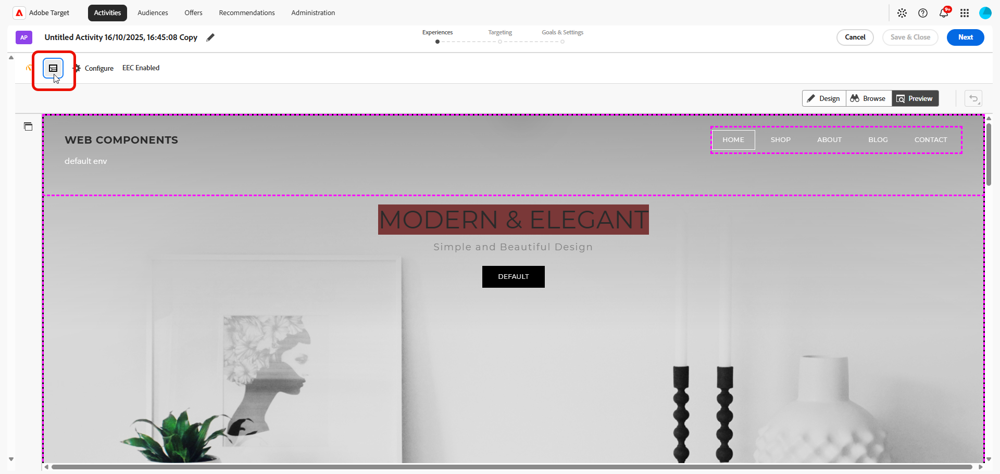

# [!UICONTROL Automated Personalization] 오퍼 타깃팅 {#target-ap-offers}

>[!BEGINSHADEBOX]

**이 페이지에서:** **[!UICONTROL Automated Personalization]** 활동에서 특정 대상에게 개별 오퍼를 타깃팅하는 방법을 알아봅니다.

>[!ENDSHADEBOX]

[!DNL Adobe Target] **[!UICONTROL Automated Personalization]**(AP) 활동에서 타깃팅 규칙을 사용하면 오퍼를 특정 대상으로 제한하여 해당 대상에 속하는 방문자만 볼 수 있도록 할 수 있습니다. 타깃팅 규칙은 방문자가 볼 수 있는 오퍼 수를 줄이고 [!DNL Target] 개인화 모델의 효과를 낮출 수 있으므로 비즈니스 요구 사항이 있을 때만 제한적으로 사용합니다.

예를 들어 3개의 오퍼가 있는 AP 활동을 고려해 보십시오. 오퍼 1에는 대상 A로 노출을 제한하는 타깃팅 규칙이 있습니다. 두 방문자가 이 활동을 봅니다.

| | 방문자 1 | 방문자 2 |
|--- |--- |--- |
| 대상자 선별 | 대상 A | 대상 B |
| 오퍼 1 [!DNL Target] 개인화 모델 점수 | 90 | 90 |
| 오퍼 2 [!DNL Target] 개인화 모델 점수 | 50 | 70 |
| 오퍼 3 [!DNL Target] 개인화 모델 점수 | 80 | 60 |

방문자 1은 대상 A의 일부로 유효하므로 이 방문자는 점수가 가장 높은 오퍼 1을 봅니다. 방문자 2는 대상 A의 일부가 아니므로 이 방문자는 가장 높은 점수가 오퍼 1에 대한 것임에도 불구하고 오퍼 2를 보게 됩니다.

## 타깃팅 규칙 설정 {#set-up-targeting-rules}

대상 타깃팅 규칙은 방문자가 각 오퍼를 볼 수 있는 를 제어하여 고객 세그먼트에 대한 오퍼 예약과 같은 특정 비즈니스 요구를 충족할 수 있습니다. 모든 규칙은 개인화 모델의 선택 항목을 좁히므로, 필요한 오퍼에만 규칙을 적용합니다.

1. 타깃팅하려는 오퍼가 포함된 [Automated Personalization 활동](/help/main/c-activities/t-automated-personalization/create-ap-activity.md#create-ap-activity)을 만들거나 편집합니다.

   50개의 위치 및 위치당 최대 250개의 오퍼를 설정할 수 있습니다.

1. **[!UICONTROL 시각적 경험 작성기]**&#x200B;에서 활동에 대한 오퍼를 설정한 후 **[!UICONTROL 콘텐츠 관리]** 아이콘()을 클릭합니다. **[!UICONTROL 콘텐츠 관리]** 대화 상자가 표시됩니다.

   

1. **[!UICONTROL 오퍼]** 탭을 클릭합니다.

1. 타깃팅할 오퍼를 선택한 다음, 오퍼를 볼 자격이 있는 대상을 선택하십시오.

   * 단일 오퍼에 대한 타깃팅을 설정하려면 오퍼 옆에 있는 추가 정보( ) 아이콘을 클릭한 다음 **[!UICONTROL 대상 타깃팅]**&#x200B;을 클릭하여 **[!UICONTROL 대상 추가]** 대화 상자를 표시합니다.
   * 여러 오퍼에 대한 타깃팅을 설정하려면 오퍼에 대한 확인란을 선택한 다음 목록 맨 아래에 표시되는 **[!UICONTROL 대상 타깃팅]** 링크를 클릭합니다.

   

1. **[!UICONTROL 대상자 추가]** 대화 상자에서 오퍼의 대상자를 선택한 다음 **[!UICONTROL 대상자 할당]**&#x200B;을 클릭하여 **[!UICONTROL 콘텐츠 관리]** 대화 상자로 돌아갑니다.

   >[!NOTE]
   >
   >새 대상을 만드는 대신 여러 대상을 기존 대상과 결합하여 온디맨드 결합 대상을 만들 수 있습니다. 자세한 내용은 [여러 대상자 결합](/help/main/c-target/combining-multiple-audiences.md#concept_A7386F1EA4394BD2AB72399C225981E5)을 참조하십시오.

1. **[!UICONTROL 완료를 클릭합니다]**.

이제 타겟팅 규칙이 선택한 오퍼에 적용되므로 할당된 대상에 속하는 방문자만 볼 수 있습니다.
