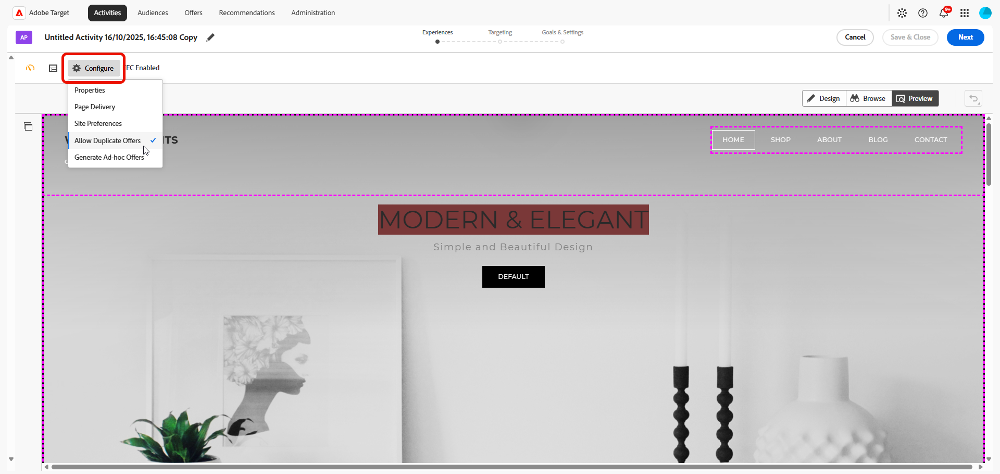

# 제외 관리 {#manage-exclusions}

>[!BEGINSHADEBOX]

**이 페이지에서:** **[!UICONTROL Automated Personalization]** 활동에서 중복 오퍼를 방지하고, 특정 경험을 제외하며, 기본 콘텐츠를 제외하는 방법을 알아봅니다.

>[!ENDSHADEBOX]

제외는 **[!UICONTROL Automated Personalization]**(AP) 활동에서 제공하는 오퍼 및 경험을 제어합니다. 동일한 오퍼가 두 번 표시되지 않도록 하고, 함께 작동하지 않는 오퍼 조합을 제거하고, 기본 콘텐츠를 제거하여 활동이 목표 및 대상자와 일치하는 더 깨끗하고 더 적절한 경험을 제공하도록 합니다.

## 중복 오퍼 허용 또는 허용 안 함 {#allow-duplicate-offers}

AP 활동의 여러 위치에서 사용하는 경우 오퍼 라이브러리의 오퍼가 복제되지 않도록 합니다.

예를 들어 활동에는 12개의 오퍼가 있는 페이지에서 6개의 위치가 있을 수 있으므로 동일한 오퍼를 두 개 이상의 위치에 배치할 수 있습니다. 중복 오퍼를 허용하지 않으면 동일한 오퍼가 동일한 활동 내의 다른 위치에 동시에 표시되지 않습니다.

1. [AP 활동을 만들거나 편집](/help/main/c-activities/t-automated-personalization/create-ap-activity.md#create-ap-activity)하는 동안 **[!UICONTROL 구성]** 아이콘()을 클릭하십시오.

1. 필요에 따라 이 기능을 켜거나 끄려면 **[!UICONTROL 중복 오퍼 허용]**&#x200B;을 클릭하세요.

   

## 특정 경험 제외 {#exclude-experiences}

특정 경험을 제외하여 AP 활동에서 특정 오퍼 조합을 제거합니다. 일부 조합이 함께 작동하지 않거나 테스트된 경험 수를 제한하여 활동의 트래픽 요구 사항을 줄일 수 있습니다.

1. [AP 활동을 만들거나 편집하는 동안](/help/main/c-activities/t-automated-personalization/create-ap-activity.md#create-ap-activity) **[!UICONTROL 콘텐츠 관리]** 아이콘()을 클릭합니다.

   **[!UICONTROL 경험]** 목록에는 모든 컨텐츠 및 위치 선택 사항들의 순열에서 생성된 각 경험이 표시됩니다.

1. 테스트하지 않을 경험을 제외합니다.

   * 단일 경험을 제외하려면 **[!UICONTROL 추가 작업]** 아이콘()을 클릭한 다음 **[!UICONTROL 제외]**&#x200B;를 클릭합니다.
   * 여러 경험을 한 번에 제외하려면 각 경험에 대한 확인란을 선택한 다음 **[!UICONTROL 제외]**&#x200B;를 클릭합니다. 하나 이상의 경험을 선택하면 **[!UICONTROL 제외]** 아이콘이 표시됩니다.

   

   이제 경험이 활동에서 제외되며 **[!UICONTROL 상태]**&#x200B;가 **[!UICONTROL 제외됨]**(으)로 표시됩니다.

## 기본 콘텐츠 제외 {#exclude-default-content}

위치에 기본 컨텐츠와 다른 하나의 오퍼만 포함되도록 AP 활동에 포함되지 않게 하려면 기본 컨텐츠를 제외하십시오. 또한 이 접근 방식을 사용하면 테스트하는 오퍼에 맞게 나머지 페이지의 모양과 느낌을 변경할 수 있습니다. 예를 들어 오퍼의 색상 팔레트와 일치시키기 위해 페이지의 배경색을 변경하고 기본 배경색을 제외할 수 있습니다.

1. [AP 활동을 만들거나 편집하는 동안](/help/main/c-activities/t-automated-personalization/create-ap-activity.md#create-ap-activity) 바꿀 콘텐츠를 선택한 다음 **[!UICONTROL 텍스트/HTML 변경]**, **[!UICONTROL 이미지 오퍼 변경]** 또는 **[!UICONTROL 배경색 변경]**&#x200B;을 클릭합니다. 사용 가능한 옵션은 콘텐츠 유형에 따라 다릅니다.

   

1. 새 콘텐츠를 만듭니다.

1. **[!UICONTROL 추가 작업]** 아이콘()을 클릭한 다음 **기본 오퍼 제외/기본 오퍼 포함** 전환을 클릭하여 기본 오퍼를 제외하거나 포함합니다.

   <!--
   Depending on the content or offer type, the [!UICONTROL Include] checkbox is in a slightly different place. 

   For Text/HTML content: 

   

   For Image/Video content: 

   

   For background color: 

   
   -->

<!--
1. Click **[!UICONTROL Save]**.

   You can see the experiences created from the offers you specified under [!UICONTROL Manage Content]. You notice that no experiences are created in [!UICONTROL Manage Content] using the default offer you excluded. 

   

**To exclude default content using the [!UICONTROL Form-Based Experience Composer]:** 

1. While creating or editing an AP activity, click **[!UICONTROL Change Text/HTML]** or **[!UICONTROL Change Image Offer]** under **[!UICONTROL Content]**. 
1. In the dialog box, create your new content and uncheck **[!UICONTROL Include]** to the right of the default content (or uncheck the Default Image/Video in the [!UICONTROL Select Content] screen). 

   Depending on the content or offer type, the [!UICONTROL Include] checkbox is in a slightly different place. 

   For Text/HTML content: 

   

   For Image/Video content: 

   

1. Click **[!UICONTROL Save]**. 

   You can see the experiences created from the offers you specified under [!UICONTROL Manage Content]. You notice that no experiences are created in [!UICONTROL Manage Content] using the default offer you excluded. 

   
-->
