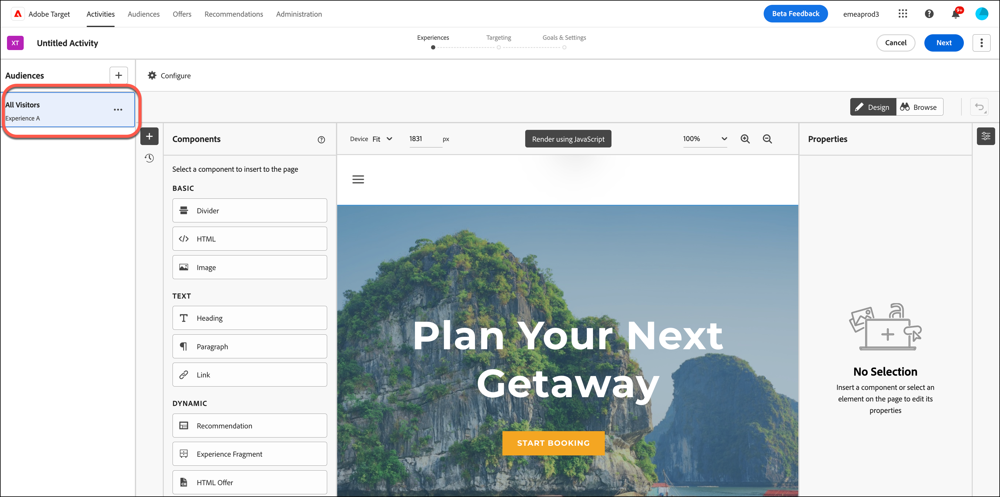
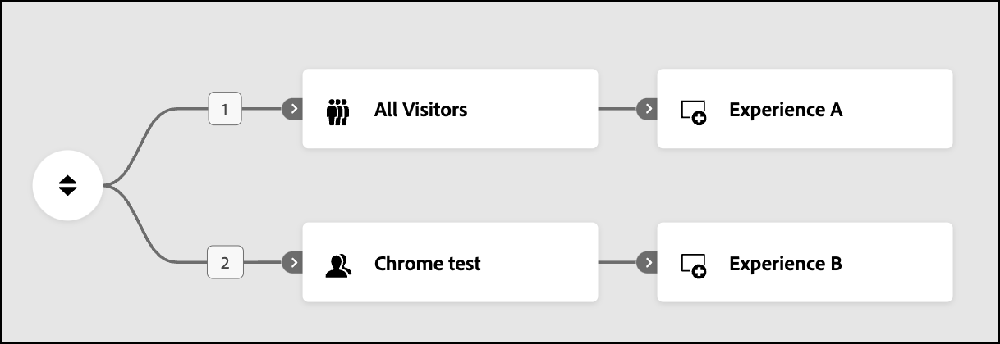
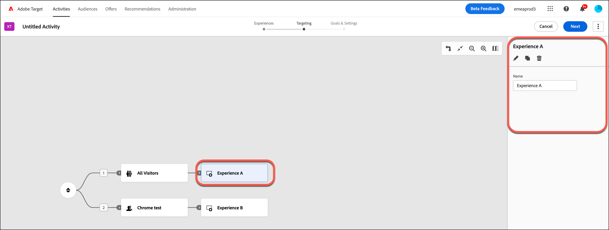

# [!UICONTROL 경험 타깃팅]&#x200B;(XT) 활동에서 경험 만들기 {#xt-add-experience}

>[!BEGINSHADEBOX]

**이 페이지에서:** 경험을 만들고 경험 타깃팅 활동의 대상에게 타깃팅하는 방법, 순서대로 배치하는 방법, 이름 변경, 편집, 복제 또는 삭제하는 방법에 대해 알아봅니다.

>[!ENDSHADEBOX]

[!DNL Adobe Target]의 **[!UICONTROL 시각적 경험 작성기]**(VEC)는 **[!UICONTROL 경험 타깃팅]**(XT) 활동에서 페이지에서 경험을 편집할 수 있는 시각적 인터페이스를 제공합니다.

* [타깃팅된 경험 만들기](#create-experiences)
* [경험 순서 바꾸기](#reorder-experiences)
* [경험 이름 변경, 편집, 복제 또는 삭제](#manage-experiences)

## 타깃팅된 경험 만들기 {#create-experiences}

[경험 타깃팅 **[!UICONTROL 활동을 만드는 중]**](/help/main/c-activities/t-experience-target/t-xt-create/xt-create.md)에 안내가 있는 3단계 워크플로(**[!UICONTROL 경험]**) 중 1단계는 **[!UICONTROL 모든 방문자]** 대상이 있는 기본 **[!UICONTROL 경험 A]**&#x200B;을(를) 표시합니다.

1. 변경할 요소를 선택하고 원하는 대로 변경합니다. 이제 변경한 내용이 **[!UICONTROL 경험 A]**&#x200B;에 적용됩니다.

   페이지의 요소 위로 마우스를 가져가면 요소가 강조 표시됩니다. 강조 표시된 요소는 VEC를 사용하여 변경할 수 있습니다. 요소에서 수행하여 경험을 변경할 수 있는 작업 목록은 [시각적 경험 작성기 선택 사항](/help/main/c-experiences/c-visual-experience-composer/viztarget-options.md)을 참조하십시오.

   >[!NOTE]
   >
   >기본적으로, VEC에서는 회전 배너 등과 같은 JavaScript가 포함된 요소를 변경할 수 없습니다. JavaScript을 비활성화하여 VEC를 사용하여 해당 요소를 변경할 수 있습니다.

1. 추가 경험을 만들려면 **[!UICONTROL 추가]**( )를 클릭합니다.

   **[!UICONTROL 대상자 추가]** 대화 상자가 표시됩니다. 경험을 대상으로 타깃팅하려면 경험을 추가하기 전에 대상을 선택하십시오.

   +++ 대상자에 대한 자세한 정보

   대상자 라이브러리에는 [!DNL Target]의 일부로 사전에 만들어진 공통 대상자를 포함하여 이전에 정의한 대상자가 포함되어 있습니다. 라이브러리에서 대상자를 선택하거나, [새 대상자를 만듭니다](/help/main/c-target/c-audiences/audiences.md#concept_65BE870D290E412D8BBF557EEA67C271).

   기존 대상을 선택할 수 있을 뿐만 아니라, 새 대상을 만들지 않고 여러 대상을 결합하여 주문형 결합 대상을 만들 수도 있습니다. 자세한 내용은 [여러 대상자 결합](/help/main/c-target/combining-multiple-audiences.md#concept_A7386F1EA4394BD2AB72399C225981E5)을 참조하십시오.

   대상을 만들 때 위치를 선택하고 해당 위치에 대한 매개 변수를 지정할 수 있습니다. **[!UICONTROL 사용자 지정]**(**[!UICONTROL 대상 만들기]** > **[!UICONTROL 사용자 지정]**)에서 위치를 선택한 다음 원하는 매개 변수를 지정합니다.

   대상 목록을 연 상태에서 가져온 대상이 10분 이상 오래되면 배경에서 자동으로 대상을 가져옵니다.

   +++

1. 경험을 타깃팅할 대상을 한 명 이상 선택한 다음 **[!UICONTROL 대상 할당]**&#x200B;을 클릭합니다.

   이제 **[!UICONTROL 경험 B]**&#x200B;이(가) 이전 일러스트레이션에 표시되며 이 경험은 적절한 대상자를 대상으로 합니다.

1. 이 경험에 대해 변경할 요소를 선택하고 1단계에서 설명한 대로 원하는 대로 변경합니다.

1. 필요에 따라 이전 단계를 반복하여 타깃팅된 추가 경험을 만듭니다.

1. 환경 디자인을 마치면 **[!UICONTROL 다음]**&#x200B;을 클릭하세요.

   활동 다이어그램이 표시됩니다.

   

>[!NOTE]
>
>기본 페이지 이외의 소스에서 가져온 이미지(예: `akamai.net`에 호스팅되고 `adobe.com`에 전달된 이미지)를 전달할 수 있습니다. 다른 곳에서 호스팅된 이미지는 흐름 다이어그램에 표시된 페이지의 썸네일에 표시되지 않습니다.

## 경험 순서 바꾸기 {#reorder-experiences}

**[!UICONTROL 경험 타깃팅]** 활동을 만들거나 편집하는 동안 대상 및 경험 쌍을 원하는 순서로 배열할 수 있습니다. 방문자는 하향식으로 경험에 대해 평가됩니다. **[!UICONTROL 경험 타깃팅]**&#x200B;은(는) 순서가 중요하다고 가정합니다. 방문자가 첫 번째 대상 및 경험 쌍에 속하면 첫 번째 경험이 전달됩니다.

쌍의 순서를 바꾸려면 순서 바꾸기 아이콘( )을 클릭하여 오른쪽에 **[!UICONTROL 경험]** 열을 표시한 다음 원하는 대로 경험을 다시 정렬합니다.

+++ 예: 함께 사용할 수 없는 대상

**[!UICONTROL 경험 타기팅]** 활동을 만드는 동안 순서가 중요하다는 것을 알지 못했다고 가정해 봅시다. 나중에 테스트 중에 경험 B 또는 C에 대한 자격이 있어야 한다고 생각하는 방문자가 대신 경험 A에 대한 자격이 있음을 알게 됩니다. 이러한 상황은 대상이 상호 배타적이지 않고 적절한 순서가 아니기 때문일 수 있습니다(예: 경험 A = 미국, 경험 B = 샌프란시스코, 경험 C = 캘리포니아).

이 시나리오에서는 샌프란시스코나 캘리포니아에 있는 다른 곳에 있더라도 미국에서 온 모든 사용자가 경험 A에 대한 자격이 있습니다. 전체 활동을 다시 생성하지 않고, 가장 제한적이었던 대상 및 경험 쌍을 가장 덜 제한적인 것에서 가장 덜 제한적인 것으로(샌프란시스코 > 캘리포니아 > 미국) 재정렬할 수 있습니다.

+++

**[!UICONTROL 모든 방문자]** 대상이 있는 경우 다이어그램에서 첫 번째 대상이 아닌지 확인하십시오. &quot;**[!UICONTROL 모든 방문자]**&quot;을(를) 대상으로 하는 경험은 다른 경험에 속한 적이 없는 모든 방문자를 &quot;찾기 위한&quot; **[!UICONTROL 경험 타깃팅]** 활동의 마지막 경험으로 사용할 수 있습니다.

## 경험 이름 변경, 편집, 복제 또는 삭제 {#manage-experiences}

**[!UICONTROL 경험 타깃팅]** 활동의 다이어그램에서 경험을 클릭하여 오른쪽에 **[!UICONTROL 경험]** 열을 표시합니다.

필요에 따라 다음 옵션 중에서 선택합니다.

* **[!UICONTROL 이름 바꾸기]**: **[!UICONTROL 이름]** 필드에 원하는 이름을 입력합니다.
* **[!UICONTROL 편집]**: 편집 아이콘()을 클릭한 다음 원하는 대로 변경합니다.
* **[!UICONTROL 복제]**: **[!UICONTROL 경험 타깃팅]** 활동에서 경험을 복사하면 전체 경험을 다시 만들 필요 없이 간단한 변경을 수행할 수 있습니다. **[!UICONTROL 복제]** 아이콘( )을 클릭한 다음 필요에 따라 경험을 편집합니다.
* **[!UICONTROL 삭제]**: **[!UICONTROL 삭제]** 아이콘()을 클릭한 다음 삭제를 확인합니다.

## 교육 비디오: 시각적 경험 작성기 사용

이 비디오는 **[!UICONTROL 경험 타깃팅]**(VEC) 옵션 사용에 대한 정보를 제공합니다.

* 페이지 콘텐츠 변경
* 페이지 레이아웃 변경

>[!VIDEO](https://video.tv.adobe.com/v/17399)
