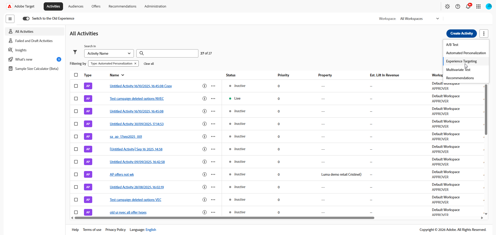
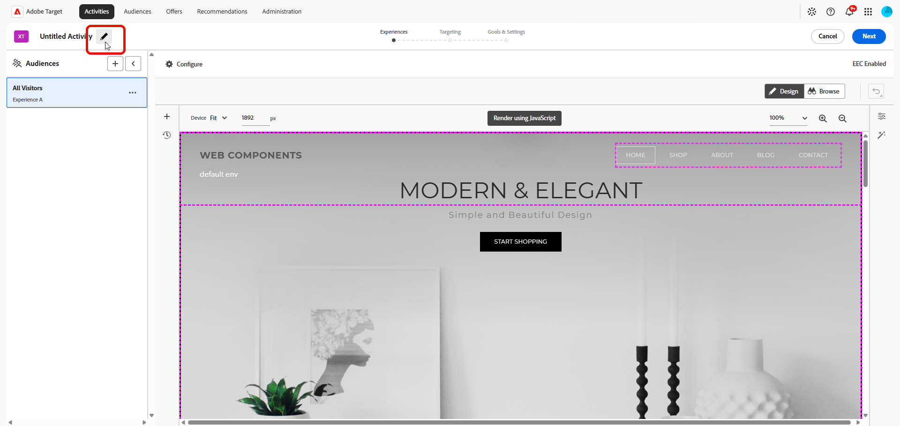

# [!UICONTROL 경험 타깃팅]&#x200B;(XT) 활동 만들기 {#create-xt-activity}

>[!BEGINSHADEBOX]

**이 페이지에서:** **[!UICONTROL 시각적 경험 작성기]**(VEC)에서 **[!UICONTROL 경험 타깃팅]**(XT) 활동을 만드는 방법을 알아봅니다. 활동을 만들고, 다른 대상에 타깃팅된 경험을 추가한 다음 목표 및 설정을 구성합니다.

>[!ENDSHADEBOX]

[!DNL Target]을(를) 사용할 수 있는 페이지에서 **[!UICONTROL 경험 타깃팅]**(XT) 활동을 만들고 [!DNL Adobe Target] 내에서 해당 페이지의 부분을 수정하려면 **[!UICONTROL 시각적 경험 작성기]**(VEC)를 사용하십시오.

**[!UICONTROL 경험 타깃팅]**(XT)에서는 마케터가 정의한 규칙 및 기준에 따라 콘텐츠를 특정 대상에 전달합니다. [지역 타기팅](/help/main/c-target/c-audiences/c-target-rules/geo.md)을 포함하여 특정 경험이나 콘텐츠를 특정 대상으로 타기팅하는 규칙을 정의하는 데 유용합니다. 활동에서 여러 규칙을 정의하여 다른 대상자에 다양한 콘텐츠 변형을 전달할 수 있습니다.

**[!UICONTROL 경험 타깃팅]**, 사용 사례 시나리오 및 교육 비디오에 대한 자세한 내용은 [경험 타깃팅](/help/main/c-activities/t-experience-target/experience-target.md)을 참조하십시오.

1. **[!UICONTROL 활동]** 목록에서 **[!UICONTROL 활동 만들기]** > **[!UICONTROL 경험 타깃팅]**&#x200B;을 클릭합니다.

   >[!NOTE]
   >
   >사용 가능한 활동 유형은 [!DNL Target] 계정에 따라 다릅니다. 일부 활동 유형은 목록에 표시되지 않을 수 있습니다. 예를 들어 **[!UICONTROL Automated Personalization]**&#x200B;은(는) [Target Premium 기능](/help/main/c-intro/intro.md#premium)입니다.
   >
   >[!DNL Target]에서 사용 가능한 다양한 활동 유형과 그 차이점에 대한 자세한 내용은 [활동](/help/main/c-activities/activities.md#concept_D317A95A1AB54674BA7AB65C7985BA03)을 참조하십시오. 필요한 활동 유형 세트를 결정하는 데 도움이 되는 [타겟 활동 유형](/help/main/c-activities/target-activities-guide.md)을 참조하십시오.

   

1. **[!UICONTROL 경험 타깃팅 활동 만들기]** 대화 상자에서 경험 작성기를 선택합니다.

   * **[!UICONTROL Visual]**.
   * **[!UICONTROL 양식 기반 경험 작성기]**&#x200B;에서 자세한 내용은 [양식 기반 경험 작성기](/help/main/c-experiences/form-experience-composer.md)를 참조하십시오.

   >[!NOTE]
   >
   >VEC 및 **[!UICONTROL 양식 기반 경험 작성기]** 외에 [!DNL Target]에서 단일 페이지 응용 프로그램 VEC를 제공합니다. 여러 작성기에 대한 자세한 내용은 [경험 및 오퍼](/help/main/c-experiences/experiences.md)를 참조하십시오.
   >
   >VEC에 대한 문제 해결 정보는 [시각적 경험 작성기 문제 해결](/help/main/c-experiences/c-visual-experience-composer/r-troubleshoot-composer/troubleshoot-composer.md)을 참조하십시오.

1. (조건부) [!DNL Target Premium] 고객인 경우 [작업 영역을 선택](/help/main/administrating-target/c-user-management/property-channel/property-channel.md)합니다.

1. [활동 URL](/help/main/c-activities/t-test-ab/t-test-create-ab/ab-activity-url.md#ab-activity-url)을 지정한 다음 **[!UICONTROL 만들기]**&#x200B;를 클릭합니다. VEC가 열리고 URL에 지정된 페이지가 표시됩니다.

   계정이 [기본 URL로 구성](/help/main/administrating-target/visual-experience-composer-set-up.md)된 경우 기본적으로 해당 URL이 표시됩니다. 필요한 경우 기본값에서 다른 URL로 변경할 수 있습니다.

1. 활동의 이름을 지정하려면 **[!UICONTROL 편집]** 아이콘()을 클릭하고 활동에 대한 수사적 이름을 지정한 다음 **[!UICONTROL 저장]**&#x200B;을 클릭합니다.

   {{activity-name-rules}}

   

1. 다른 대상을 타깃팅한 새로운 경험을 만듭니다. 단계별 지침은 [경험 추가](/help/main/c-activities/t-experience-target/t-xt-create/xt-add-experience.md#xt-add-experience)를 참조하십시오.

1. 활동에 대한 [목표 및 설정](/help/main/c-activities/t-test-ab/t-test-create-ab/ab-goals-and-settings.md#ab-goals-and-settings)을 지정합니다.
