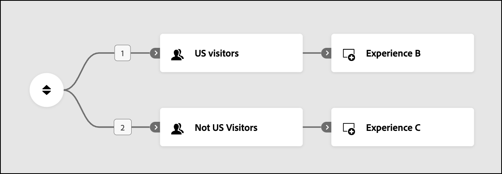

# [!UICONTROL 경험 타깃팅]에서 경험 전환 {#switching-experiences}

>[!BEGINSHADEBOX]

**이 페이지에서:** **[!UICONTROL 경험 타깃팅]** 활동에서 우선 순위가 작동하는 방식과 프로필이 발전함에 따라 방문자가 경험 간에 전환하는 경우를 알아봅니다.

>[!ENDSHADEBOX]

**[!UICONTROL 경험 타깃팅]**&#x200B;을 통해 프로필이 발전함에 따라 방문자가 보게 되는 경험을 제어할 수 있습니다. 방문자의 프로필은 몇 가지 방법으로 변경될 수 있으며 이러한 변경 사항에 따라 다른 콘텐츠를 제공할 수 있습니다. 다음 표에는 몇 가지 예가 나와 있습니다.

| 시나리오 | 세부 사항 |
|--- |--- |
| 지리적 위치 | 방문자가 출장 또는 여가를 위해 여행 중인 경우 다른 지리적 위치에서 웹 사이트 또는 모바일 앱을 볼 수 있습니다. |
| 고객 상태 | 방문자는 계정을 생성하거나 제품을 구매하기 전에 잠재고객으로 간주될 수 있습니다. |
| 카테고리 친화성 | [!DNL Target]의 [카테고리 선호도](/help/main/c-target/c-visitor-profile/category-affinity.md) 기능은 방문자가 보는 카테고리를 자동으로 캡처한 다음 타깃팅을 위해 각 카테고리의 방문자 선호도를 계산합니다. 예를 들어 웹 사이트에서 특정 주제에 대한 여러 문서를 열람한 방문자에게는 해당 주제와 관련된 콘텐츠가 제공됩니다. |
| 요일 | 주말이 다가오면 영화, 음식점 또는 기타 형태의 엔터테인먼트에 대한 콘텐츠를 방문자에게 보여주려고 할 수 있습니다. |

[!DNL Target]에서 이러한 기능을 사용하려면 **[!UICONTROL 경험 타깃팅]** 활동을 사용할 때 다음 정보를 이해하는 것이 중요합니다.

## 방문자 제공 방법 {#how-visitors-are-served}

[!DNL Target] UI의 경험 순서가 위에서 아래로 제어되므로 우선순위가 더 넓은 경험 전에 더 많은 타겟팅된 경험을 정의합니다. 다음 표에는 방문자가 각 상황에서 보게 되는 내용이 요약되어 있습니다.

| 상황 | 방문자에게 표시되는 항목 |
|--- |--- |
| 방문자는 둘 이상의 대상에 대해 자격이 있습니다. | 우선순위가 더 높은 경험의 콘텐츠. |
| 방문자는 우선순위가 더 높은 경험의 대상에 대해 자격이 부여됩니다. | 방문자가 우선순위가 더 높은 경험으로 전환됩니다. |
| 방문자는 현재 대상에 대해 자격이 중지되지만 우선순위가 낮은 경험에 대해 자격부여를 시작합니다. | 방문자가 우선순위가 낮은 경험으로 전환합니다. |
| 방문자는 현재 경험에 대한 자격을 중단하고 다른 경험에 대한 자격은 받지 않습니다. | 기본 콘텐츠. |
| 이 방문자는 다른 경험에 대한 자격이 없으며, 마지막 경험은 &quot;모든 방문자&quot;를 대상으로 합니다. | &quot;모든 방문자&quot; 경험. 이 경험은 다른 경험에 대해 자격이 없는 방문자를 &quot;catch&quot;합니다. |
| &quot;모든 방문자&quot;를 대상으로 하는 경험이 해당 순서의 마지막 경험이 아닙니다. | &quot;모든 방문자&quot; 경험보다 아래에 나열된 타겟팅된 경험은 여전히 평가됩니다. |
| 활동에는 단일 경험이 있으며 방문자는 대상에 대한 자격이 중단됩니다. | 방문자는 경험에 유지됩니다. |

## 예 {#examples}

다음 예제는 이러한 상황을 보여 줍니다.

### 우선 순위: 뉴욕 및 미국

두 개의 경험, 즉 &quot;미국&quot;을 대상으로 한 경험과 &quot;뉴욕&quot;을 대상으로 한 경험이 있는 경우 뉴욕에 있는 방문자는 두 대상 모두에 대한 자격이 됩니다. 따라서 [!DNL Target] UI에서 &quot;미국&quot; 경험 전에 &quot;뉴욕&quot; 경험을 정의해야 합니다. 이 방법을 사용하면 다음 예와 같이, 타겟팅이 많은 &quot;뉴욕&quot; 경험에 더 높은 우선 순위가 부여됩니다.

### 우선순위가 더 높은 경험으로 전환: 미국 - 독일

다음 활동 설정에서 방문자는 미국에서 여러분의 웹 사이트에 액세스한 다음, 독일로 여행을 가서 두 번째로 해당 웹 사이트를 방문했습니다. 첫 번째 방문 동안 이 방문자에게는 경험 A(미국 방문자)의 자격이 부여되었습니다. 독일에서 해당 웹 사이트를 열람한 후에 이 방문자는 경험 B(독일 방문자)로 전환되었습니다.

### 청중 떠나기: 미국-프랑스

다음 활동 설정에서 방문자는 미국에서 여러분의 웹 사이트에 액세스한 다음, 프랑스로 여행을 가서 두 번째로 해당 웹 사이트를 방문했습니다. 첫 번째 방문 동안 이 방문자에게는 경험 A(미국 방문자)의 자격이 부여되었습니다. 프랑스에서 웹 사이트를 열람한 후에도 이 방문자는 원래 경험에 유지됩니다.

### 모든 방문자를 대상으로 하는 경험

다음 활동 설정에서 방문자는 미국에서 여러분의 웹 사이트에 액세스한 다음, 독일로 여행을 가서 두 번째로 해당 웹 사이트를 방문했습니다. 첫 번째 방문 동안 이 방문자에게는 경험 A(미국 방문자)의 자격이 부여되었습니다. 이 방문자는 독일에서 웹 사이트를 열람한 후에도 경험 A(미국 방문자)에 유지됩니다.

이를 원치 않을 경우 다음 예와 같이 타기팅된 대상자의 역으로 명시적으로 정의된 새 대상자를 만들 수 있습니다.

### 단일 경험 활동

단일 경험 **[!UICONTROL 경험 타깃팅]** 활동을 사용하면 방문자가 해당 경험에 넣은 대상에 대한 자격을 중단하더라도 경험에 유지됩니다. 이를 원치 않을 경우, 역대상(예: &quot;미국&quot;이 아닌 &quot;미국&quot;이 아님)으로 타깃팅된 다른 경험을 만들 수 있습니다. 다른 옵션으로는 다음 예와 같이 100% 트래픽 할당으로 원하는 대상자를 타깃팅하는 **[!UICONTROL A/B 테스트]** 활동을 만들 수 있습니다.

