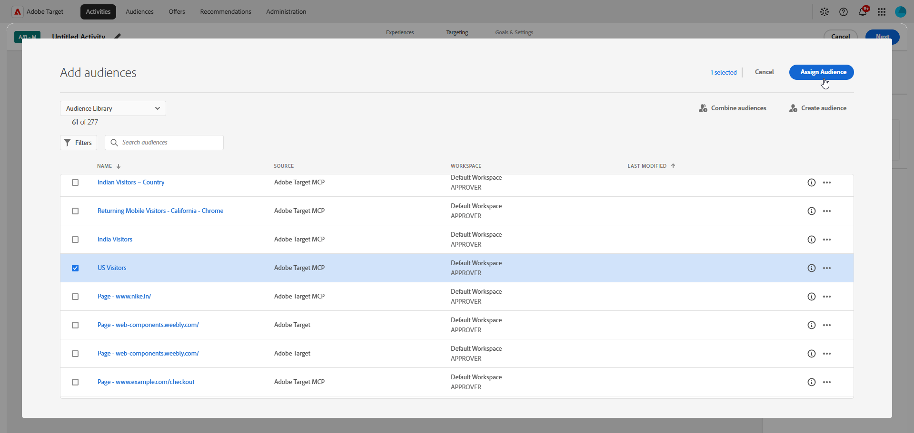

# 대상자 선택 {#select-audience}

>[!BEGINSHADEBOX]

**이 페이지에서:** A/B 활동의 대상을 선택, 만들기, 결합, 보기, 편집 및 복사하는 방법과 포함할 방문자의 비율을 설정하는 방법에 대해 알아봅니다.

>[!ENDSHADEBOX]

대상은 자격 있는 방문자가 [!DNL Adobe Target] 활동에 입력되는지 확인합니다.

[활동을 만드는](/help/main/c-activities/t-test-ab/t-test-create-ab/test-create-ab.md)에서 세 부분으로 구성된 안내 워크플로의 **[!UICONTROL 타깃팅]** 단계에는 대상 및 해당 트래픽 비율을 할당하고, 트래픽 할당 방법을 선택하고, 활동의 각 경험에 대해 트래픽 할당을 지정하는 단계를 안내하는 흐름 다이어그램이 표시됩니다.

흐름 다이어그램의 모든 옵션에 대한 자세한 내용은 [A/B 테스트 활동 만들기](/help/main/c-activities/t-test-ab/t-test-create-ab/test-create-ab.md)를 참조하십시오.

## 활동에 대한 대상 선택

대상은 활동을 보는 사람을 제어합니다. 대상과 일치하는 방문자만 입장할 수 있으며 해당 방문자의 점유율을 사용자가 결정합니다. 기본적으로 이 활동은 모든 방문자를 타깃팅합니다.

1. **[!UICONTROL 모든 방문자]** 컨트롤을 클릭하여 활동에 대한 다른 대상을 선택합니다.

   **[!UICONTROL 모든 방문자]**&#x200B;가 기본 대상입니다. 특정 대상 타깃팅이 없는 A/B 테스트의 경우 기본값을 유지합니다. 다른 대상을 선택하면 해당 이름이 가장 왼쪽 컨트롤에 표시됩니다.

1. **[!UICONTROL 바꾸기] 아이콘**(  )을 클릭합니다.

   

1. **[!UICONTROL 대상 추가]** 대화 상자에서 **[!UICONTROL 대상 라이브러리]**&#x200B;에서 선택한 대상을 검색하거나 활동 전용 대상을 만들 수 있습니다.

   **[!UICONTROL 대상 라이브러리]**&#x200B;에는 [!DNL Target]의 일부로 미리 만들어진 공통 대상을 포함하여 이전에 정의된 대상이 포함되어 있습니다.

   

1. 대상 옆에 있는 **[!UICONTROL 정보]** 아이콘()을 클릭하여 원본 및 특성을 포함하여 해당 대상에 대한 세부 정보를 볼 수 있습니다.

   

   대상자에 대한 추가 세부 정보를 보려면 **[!UICONTROL 전체 세부 정보 보기]**&#x200B;를 클릭할 수도 있습니다.

1. (조건부) **[!UICONTROL 대상 결합]**&#x200B;에서 [여러 대상을 결합하는 대상 만들기](/help/main/c-target/combining-multiple-audiences.md)를 클릭합니다.

   +++ 새 대상을 만드는 절차

   **[!UICONTROL 대상 라이브러리]**&#x200B;에 없는 새 대상을 만들려면 **[!UICONTROL 대상 만들기]**&#x200B;를 클릭하고 대상을 정의한 다음 **[!UICONTROL 완료]**&#x200B;를 클릭하십시오.

   [대상자 만들기 워크플로](/help/main/c-target/c-audiences/audiences.md)에서 다음 옵션 중 선택할 수 있습니다.

   * **[!UICONTROL 대상 라이브러리]**: **[!UICONTROL 대상 라이브러리]**&#x200B;에 저장되고 다른 활동에서 다시 사용할 수 있는 온디맨드 대상을 만듭니다.
   * **[!UICONTROL 이 활동만]**: **[!UICONTROL 대상 라이브러리]**&#x200B;에 저장되지 않고 현재 활동에서만 사용할 수 있는 [활동별 대상을 만듭니다](/help/main/c-target/creating-activity-only-audience.md).

   +++

1. 원하는 대상 옆에 있는 **[!UICONTROL 추가 작업]** 아이콘()을 클릭하여 대상을 편집하거나 복사할 수 있습니다.

1. 대상을 선택한 후 **[!UICONTROL 대상 할당]**&#x200B;을 클릭합니다.

1. 오른쪽 창에서 **[!UICONTROL 방문자 비율]**&#x200B;을 클릭한 다음 활동에 포함할 자격 있는 방문자의 비율을 지정합니다.

1. 대상자가 만족스러우면 **[!UICONTROL 다음]**&#x200B;을 클릭하여 안내가 있는 3단계 워크플로의 세 번째 단계로 이동합니다.

>[!NOTE]
>
>**[!UICONTROL 대상]** 목록을 열고 가져온 대상이 10분 이상 오래되면 백그라운드에서 대상을 자동으로 가져옵니다.
