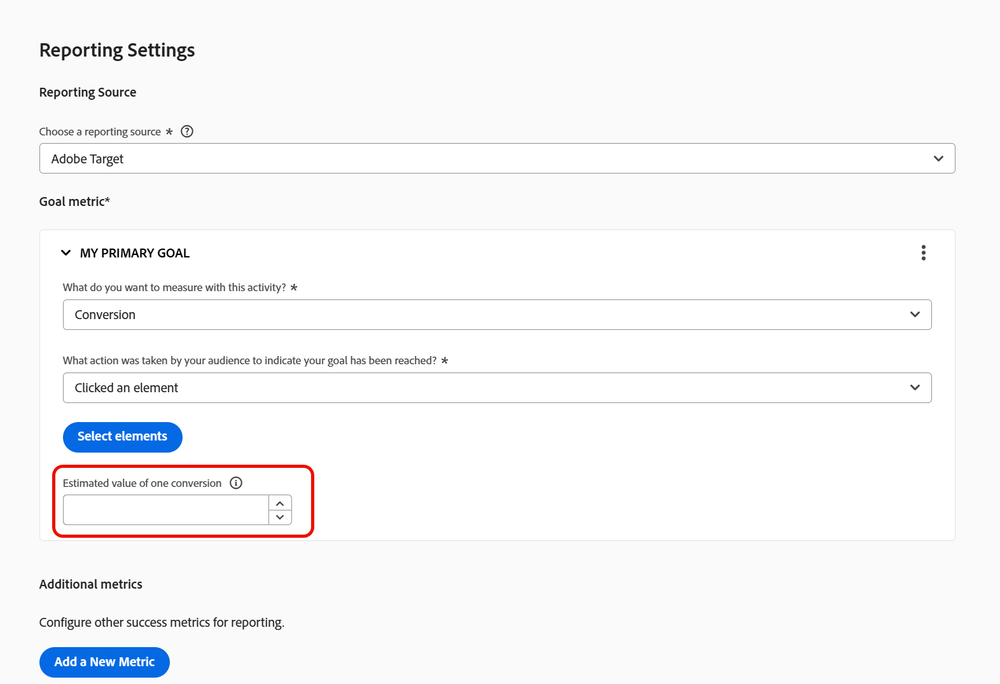
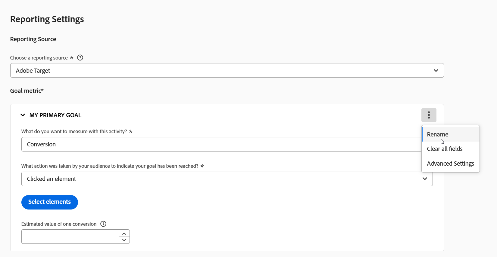

# 지표 설정 {#ab-set-metrics}

>[!BEGINSHADEBOX]

**이 페이지에서:** A/B, XT(경험 타기팅) 또는 MVT(다변량 테스트) 활동의 목표 지표와 추가 지표를 설정하는 방법을 알아보고 지표 이름에 허용되지 않는 문자를 알아봅니다.

>[!ENDSHADEBOX]

[!DNL Adobe Target] A/B, [!UICONTROL 경험 타깃팅]&#x200B;(XT) 또는 [!UICONTROL 다변량 테스트]&#x200B;(MVT) 활동에서 지표를 사용하여 방문이 성공적으로 수행된 시기를 확인합니다. 성공 지표에 대한 자세한 내용은 [성공 지표](/help/main/c-activities/r-success-metrics/success-metrics.md#overview)를 참조하십시오.

>[!NOTE]
>
>이 페이지는 [!DNL Adobe Target]이(가) 보고 소스일 때 적용됩니다. 다른 보고 원본의 경우 [[!DNL Adobe Analytics] 보고 원본으로  [!DNL Target]](/help/main/c-integrating-target-with-mac/a4t/a4t.md) and [[!DNL Target] 보고 [!DNL Adobe Customer Journey Analytics]](/help/main/c-integrating-target-with-mac/cja/target-reporting-in-cja.md)을(를) 참조하십시오.

## 지표 설정 {#set-a-metric}

1. **[!UICONTROL 목표 및 설정]** 페이지의 **[!UICONTROL 보고 설정]** 섹션에서 [성공 지표](/help/main/c-activities/r-success-metrics/success-metrics.md#overview)를 선택하십시오.

   **[!UICONTROL 지표 선택]** 옵션은 활동에 대해 선택할 수 있는 성공 지표를 나열합니다. 성공 지표는 다음 카테고리로 구분됩니다.

   * **[!UICONTROL 전환]**
   * **[!UICONTROL 매출]**
   * **[!UICONTROL 참여]**

   사전 빌드된 지표 중 하나를 사용하거나 사용자 지정 성공 지표를 만들 수 있습니다. 성공 지표를 기본 지표로 표시할 수도 있습니다. 기본 측정 항목(설정된 경우)을 표시하려면 Experience Cloud 카드 기본값을 보고합니다.

   

1. 지표에 대한 설정을 지정합니다. 사용 가능한 설정은 사용 중인 성공 지표에 따라 다릅니다.

1. 사용하도록 설정하면 **[!UICONTROL 전환 예상 값]** 필드에서 목표에 대한 값을 제공합니다.

   * 이 값을 사용하면 [!DNL Target]에서 예상 매출액 상승도를 계산할 수 있습니다.
   * 필드는 선택 사항입니다. 하지만 비수익 지표에 대한 증분 매출은 이 필드 없이 계산할 수 없습니다.
   * **[!UICONTROL 페이지 점수]** 지표에 대해 필드를 사용할 수 없습니다.
   * 데이터 유형은 통화입니다.
   * 사용자가 목표를 충족하기 위해 수행한 작업을 표시한 후 필드가 점진적으로 표시됩니다.

   자세한 내용은 [매출 상승도 평가](/help/main/administrating-target/r-target-account-preferences/estimating-lift-in-revenue.md)를 참조하십시오. 예상한 데이터를 가져오려면 성공 지표를 올바르게 구성해야 합니다.

   

1. (선택 사항) 목표 지표보다 많은 지표를 추적하려면 **[!UICONTROL 새 지표 추가]**&#x200B;를 클릭한 다음, 이전 단계에 설명된 대로 각 추가 지표를 선택하고 구성합니다.

1. 지표 설정이 끝나면 XT 활동에서 **[!UICONTROL 계속]**&#x200B;을 클릭하거나 MVT 활동에서 **[!UICONTROL 저장 및 닫기]**&#x200B;를 클릭하십시오.

## 지표 이름에 사용할 수 없는 문자 {#metric-name-rules}

지표의 이름을 지정하거나 지표의 이름을 바꾸는 경우 다음 문자가 허용되지 않습니다.

| 문자 | 설명 |
|--- |--- |
| `/` | 슬래시 |
| `?` | 물음표 |
| `#` | 숫자 기호 |
| `:` | 콜론 |
| `=` | 다음과 같음 |
| `+` | 플러스 |
| `-` | 빼기 |
| `@` | 로그인 |
