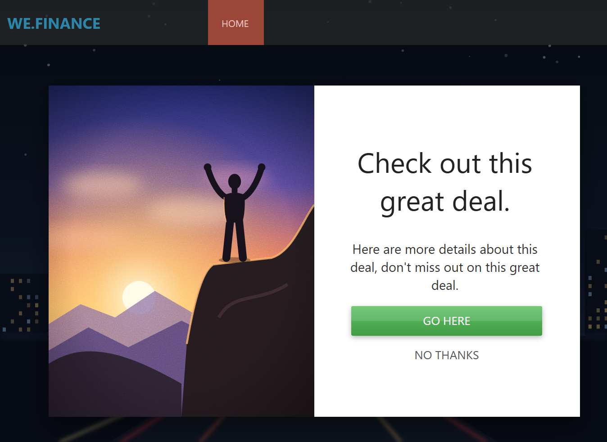

# 경험 템플릿 {#experience-templates}

>[!BEGINSHADEBOX]

**이 페이지에서:** 사용자 지정 코드에서 사용할 수 있는 [!DNL Adobe Target] 경험 템플릿과 각 템플릿에 일반적으로 사용되는 항목을 찾습니다.

>[!ENDSHADEBOX]

[!DNL Adobe Target] 경험 템플릿은 구성 가능한 입력이 있는 미리 코딩된 샘플로서, 일반적인 마케터 사용 사례를 실행하는 데 사용됩니다. VEC 또는 양식 기반 경험 작성기를 통해 일반적인 사용 사례를 실행할 수 있는 시작점으로 개발자와 마케터에게 무료로 제공됩니다.

현재 Adobe Marketing Cloud GitHub에서 다음 템플릿을 사용할 수 있습니다. [Target-Experience-Templates](https://github.com/Adobe-Marketing-Cloud/target-experience-templates).

## 썸네일을 포함하는 배너 캐러셀 {#banner-carousel-thumbnails}

[썸네일을 포함하는 배너 캐러셀 경험 템플릿](https://github.com/Adobe-Marketing-Cloud/target-experience-templates/tree/master/banner-carousel-thumbnails)은 순환 캐러셀이며, 일반적으로 홈 페이지 및 랜딩 페이지나 기타 대량 입력 페이지에서 사용됩니다. 이 회전판은 이미지를 통해 자동으로 회전하지 않습니다. 1차 이미지 아래에서 작은 이미지를 클릭하여 와 직접 상호 작용할 수 있습니다.

## 배너 캐러셀 {#banner-carousel}

[배너 캐러셀 경험 템플릿](https://github.com/Adobe-Marketing-Cloud/target-experience-templates/tree/master/banner-carousel)은 순환 캐러셀이며, 일반적으로 홈페이지 및 랜딩 페이지나 기타 대량 입력 페이지에서 사용됩니다.다. 이 회전판은 이미지를 통해 자동으로 회전하지 않습니다. 왼쪽 및 오른쪽 화살표를 클릭하여 와 직접 상호 작용할 수 있습니다.

## 배너 카운트다운 {#banner-countdown}

[배너 카운트다운 경험 템플릿](https://github.com/Adobe-Marketing-Cloud/target-experience-templates/tree/master/banner-countdown)은 중앙 카운트다운이 있는 대형 배너이며, 일반적으로 홈페이지 및 랜딩 페이지나 기타 대량 입력 페이지에서 사용됩니다.

![배너 카운트다운 템플릿: 일, 시간, 분, 초 단위로 카운트다운이 있는 대형 배너와 [여기로 이동] 단추](assets/exp-template-banner-countdown.png)

## 단추 빌더 {#button-builder}

[단추 빌더 경험 템플릿](https://github.com/Adobe-Marketing-Cloud/target-experience-templates/tree/master/button)은 클릭 유도 문안이 있는 작은 단추입니다. 버튼을 구성할 수 있습니다. 페이지의 어디에나 배치하여 새 call to action을 추가하거나 기존 단추를 구성 가능한 대체 단추로 대체할 수 있습니다.

## 카운트다운이 있는 Lightbox {#lightbox-countdown}

[카운트다운이 있는 Lightbox 경험 템플릿](https://github.com/Adobe-Marketing-Cloud/target-experience-templates/tree/master/lightbox-countdown)은 중앙 카운트다운이 있는 lightbox 오버레이 팝업이며, 일반적으로 홈페이지 및 랜딩 페이지나 기타 대량 입력 페이지에서 사용됩니다.

![카운트다운이 있는 Lightbox 템플릿: 카운트다운이 있는 팝업, [여기로 이동] 단추 및 [아니요] 링크](assets/exp-template-lightbox-countdown.png)

## Exit Intent가 있는 Lightbox {#lightbox-exit-intent}

[Exit Intent가 있는 Lightbox 경험 템플릿](https://github.com/Adobe-Marketing-Cloud/target-experience-templates/tree/master/lightbox-exit-intent)은(는) Exit Intent에서 트리거되는 Lightbox 오버레이 팝업입니다(마우스를 화면 오른쪽 상단으로 이동). 관심을 끌 수 있는 마지막 기회가 필요한 모든 웹 속성에 배포할 수 있습니다.

![Exit Intent가 있는 Lightbox 템플릿: [여기 로 이동] 단추와 [아니요] 링크를 포함하여 할인을 제공하는 팝업](assets/exp-template-lightbox-exit.png)

## Lightbox {#lightbox}

[Lightbox 경험 템플릿](https://github.com/Adobe-Marketing-Cloud/target-experience-templates)은(는) 지연이 기본 제공되는 Lightbox 오버레이 팝업이며, 일반적으로 홈페이지 및 랜딩 페이지나 기타 대량 시작 페이지에서 사용됩니다.

## 리본 {#ribbon}

[리본 경험 템플릿](https://github.com/Adobe-Marketing-Cloud/target-experience-templates/tree/master/ribbon)은(는) 웹 페이지의 맨 위에 삽입되는 100% 너비의 리본입니다. 일반적으로 반짝 판매, 무료 배송, 안전 또는 날씨 이벤트 또는 기타 중요한 알림을 표시하는 데 사용됩니다.

