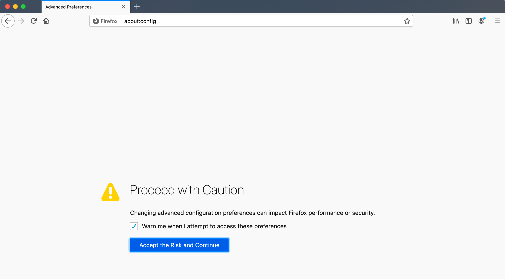

# 브라우저에서 혼합 컨텐츠 사용 {#mixed-content}

>[!BEGINSHADEBOX]

**이 페이지에서:** **[!UICONTROL 시각적 경험 작성기]**(VEC)가 HTTP 사이트 및 혼합 콘텐츠가 포함된 사이트를 열 수 있도록 [!DNL Google Chrome], [!DNL Mozilla Firefox] 및 [!DNL Microsoft Edge]에서 혼합 콘텐츠를 사용하도록 설정하는 방법에 대해 알아봅니다.

>[!ENDSHADEBOX]

HTTPS를 통해 안전하게 요청되지만 HTTPS와 HTTP 콘텐츠가 모두 로드되는 페이지에는 혼합된 콘텐츠가 포함되어 있습니다. HTTPS 콘텐츠는 안전하지만 HTTP 콘텐츠는 그렇지 않으므로 최신 브라우저는 이러한 페이지를 차단하거나 경고 메시지를 표시할 수 있습니다.

[!DNL Adobe Target]의 **[!UICONTROL VEC(시각적 경험 작성기]**)가 혼합 콘텐츠가 포함된 페이지를 열려고 하면 브라우저에서 차단을 비활성화하는 지침과 함께 경고 메시지가 표시됩니다. 차단을 비활성화하면 HTTP 사이트 또는 혼합 콘텐츠(HTTPS 및 HTTP)가 있는 사이트를 열 수 있습니다.

이전에는 혼합 콘텐츠가 허용되지 않는 경우 안내가 있는 3단계 워크플로 중 1단계의 일부 작업을 계속 사용할 수 있었습니다. 이제 [!DNL Target]이(가) 1단계의 모든 작업을 차단하므로 활동 만들기를 계속하려면 혼합 콘텐츠를 활성화해야 합니다.

브라우저의 보안 설정은 VEC와 같은 보안(HTTPS) 페이지 또는 프레임에 로드되는 비보안(HTTP) 콘텐츠를 차단할 수 있습니다. 이러한 설정을 변경할 수 있는 대안은 HTTPS 웹 사이트입니다. 웹 사이트가 비보안(HTTP) 도메인에서 실행되는 경우 VEC가 활성 혼합 콘텐츠를 로드할 수 있어야 합니다.

>[!IMPORTANT]
>
>혼합 컨텐츠 허용은 라이브 웹 사이트에는 영향을 주지 않고 VEC에만 영향을 줍니다.

자세한 내용은 *Mozilla Developer Network*(MDN) 웹 사이트의 [혼합 콘텐츠](https://developer.mozilla.org/en-US/docs/Web/Security/Mixed_content)를 참조하십시오.

## [!DNL Google Chrome]에서 혼합 콘텐츠 사용

[!DNL Chrome]은(는) 보안 연결을 통해 요청된 페이지의 콘텐츠가 안전하게 전송되었는지 확인합니다. Google Chrome 도움말의 &quot;[안전하지 않은 사이트에 대한 경고 관리](https://support.google.com/chrome/answer/99020?hl=en)&quot; 를 참조하십시오.

최신 버전의 [!DNL Chrome]&#x200B;(버전 79.0.3945.117 이상)에서 VEC를 사용하려면 사이트 설정을 다음과 같이 업데이트하십시오. 사이트 방문자는 이러한 단계를 수행할 필요가 없습니다.

1. 잠금(경고) 아이콘을 클릭한 다음 **[!UICONTROL 사이트 설정]**&#x200B;을 클릭합니다.

   연결 메뉴가 열리고 사이트 설정이 강조 표시된 

1. **[!UICONTROL 비보안 콘텐츠]**&#x200B;에서 드롭다운 목록에서 &quot;차단(기본값)&quot;을 &quot;허용&quot;으로 변경하십시오.

   

1. VEC 페이지를 다시 로드합니다.

## [!DNL Mozilla Firefox]에서 혼합 콘텐츠 사용

기본적으로 [!DNL Firefox]은(는) 보안 및 비보안 콘텐츠를 혼합하는 페이지를 차단하므로 [!DNL Target]을(를) 사용하려면 이 설정을 영구적으로 변경해야 합니다. 사이트 방문자는 이러한 단계를 수행할 필요가 없습니다.

1. [!DNL Firefox]의 주소 표시줄에 `about:config`을(를) 입력하십시오.
1. [!DNL Firefox]이(가) 표시하는 경고 메시지를 확인합니다.

   

1. 검색 창에서 `block_active`을(를) 입력합니다.

   

1. `security.mixed_content.block_active_content`을(를) 두 번 클릭합니다.

   값이 &quot;True&quot;에서 &quot;False&quot;로 변경됩니다. 값이 &quot;False&quot;를 표시하면 변경이 완료됩니다.

   

1. 이 설정을 변경한 후 컴퓨터를 다시 시작합니다.

## [!DNL Microsoft Edge]에서 혼합 콘텐츠 사용

[!DNL Edge]은(는) 보안 연결을 통해 요청된 페이지의 콘텐츠가 안전하게 전송되었는지 확인합니다. 최신 버전의 [!DNL Edge]에서 VEC를 사용하려면 사이트 설정을 다음과 같이 업데이트하십시오. 사이트 방문자는 이러한 단계를 수행할 필요가 없습니다.

1. [!DNL Edge]에서 메뉴 모음의 **[!DNL Microsoft Edge]**&#x200B;을(를) 클릭하고 **[!UICONTROL 설정]**&#x200B;을(를) 클릭한 다음 **쿠키 및 사이트 권한**&#x200B;을(를) 클릭합니다.
1. **[!UICONTROL 비보안 콘텐츠]**(으)로 스크롤하여 클릭합니다.
1. **[!UICONTROL 허용]** 옆에 있는 **[!UICONTROL 추가]**&#x200B;를 클릭하고 비보안 콘텐츠를 허용할 사이트를 입력한 다음 **[!UICONTROL 추가]**&#x200B;를 클릭합니다.
1. VEC 페이지를 다시 로드합니다.
