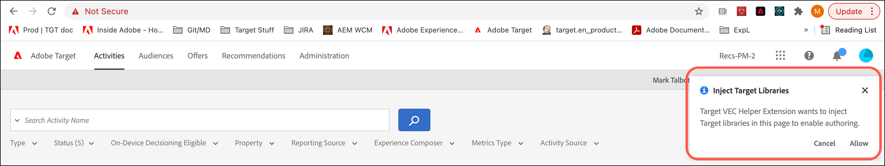

# [!UICONTROL 시각적 경험 작성기] 도우미 확장 {#vec-helper-extension}

>[!BEGINSHADEBOX]

**이 페이지에서:** 기존 VEC Helper 브라우저 확장 프로그램이 **[!UICONTROL 시각적 경험 작성기]**(VEC)에서 웹 사이트를 로드하는 방법과 웹 사이트를 설치하고 사용하는 방법을 알아봅니다.

>[!ENDSHADEBOX]

[!DNL Google Chrome]용 [!DNL Adobe Target] **[!UICONTROL VEC(시각적 경험 작성기]**) Helper 브라우저 확장 프로그램은 VEC에서 웹 사이트를 안정적으로 로드하므로 웹 경험을 더 빨리 작성하고 확인할 수 있습니다. [!DNL Mozilla Firefox]에서는 확장이 필요하지 않습니다.

>[!IMPORTANT]
>
>* 이 문서에 설명된 레거시 [!DNL Target] VEC Helper 확장 프로그램은 매니페스트 V2를 사용하여 만들어졌습니다. [!DNL Google]이(가) 2024년 6월부터 Manifest V2로 만든 확장을 허용하지 않는다고 발표했습니다. 자세한 내용은 *개발자용 Chrome* 사이트에서 [!DNL Google]의 [Manifest V2 지원 타임라인 공지](https://developer.chrome.com/docs/extensions/develop/migrate/mv2-deprecation-timeline){target=_blank}를 참조하십시오.
>
>* 2024년 6월부터 [!DNL Google]은(는) 이 문서에 설명된 확장을 포함하여 Manifest V2로 만든 확장을 사용하지 않도록 설정합니다. [!DNL Adobe]에서는 가능한 한 빨리 최신 [Visual Editing Helper 확장 기능](/help/main/c-experiences/c-visual-experience-composer/r-troubleshoot-composer/visual-editing-helper-extension.md)(으)로 이동하는 것이 좋습니다.

## 일부 웹 사이트가 VEC에서 안정적으로 열리지 않는 이유

다음과 같은 이유로 VEC에서 웹 사이트가 안정적으로 열리지 않을 수 있습니다.

* 웹 사이트에 엄격한 보안 정책이 있습니다.
* 웹 사이트가 iframe으로 되어 있습니다.
* at.js 라이브러리가 아직 웹 사이트에서 구현되지 않았습니다.
* 고객의 QA 또는 스테이징 사이트는 내부에 있으며 네트워크 외부에서 사용할 수 없습니다.
* 웹 사이트에서 [서비스 작업자](https://developer.mozilla.org/en-US/docs/Web/API/Service_Worker_API){target=_blank}(SW)를 사용합니다. VEC는 현재 제한 사항만 지원합니다. 다음 섹션을 참조하십시오.
* 웹 사이트가 [!DNL Chrome] 80 이상에서 열려 SameSite 쿠키 정책을 적용합니다. 자세한 내용은 [Google Chrome SameSite 쿠키 정책](/help/main/c-experiences/c-visual-experience-composer/r-troubleshoot-composer/issues-related-to-the-visual-experience-composer-vec-and-enhanced-experience-composer-eec.md#samesite)을 참조하십시오.

[!DNL Chrome]용 VEC Helper 브라우저 확장 프로그램은 고객이 [!DNL Target] [고급 경험 작성기](/help/main/administrating-target/visual-experience-composer-set-up.md#eec) 또는 Requestly와 같은 타사 확장 프로그램에 의존하고 있는 사이트 로드 문제를 해결합니다.

### 서비스 작업자

서비스 작업자(SW)는 웹 페이지가 해당 도메인에 대한 요청을 가로채기 위해 설치하는 웹 기술입니다. SW는 페이지 방문 후에도 유지되며 이후 방문 시 자동으로 활성화됩니다. 전달되는 요청과 이전되어 캐시에서 처리되는 요청을 결정합니다.

SW는 웹 페이지 자체, JS, CSS, IMG 및 AJAX 요청과 같은 정적 리소스, 해당 콘텐츠 및 응답 헤더를 캐시할 수 있습니다. 이러한 헤더에는 [Target VEC Helper 확장 프로그램](/help/main/c-experiences/c-visual-experience-composer/r-troubleshoot-composer/vec-helper-browser-extension.md)에서 제거를 시도하는 헤더(예: `X-Frame-Options: SAMEORIGIN`, CSP(`Content-Security-Policy`) 및 `Set-Cookie`)가 포함됩니다.

웹 요청을 가로채는 [!DNL Chrome] 확장 API는 SW가 가로채고 처리한 요청을 받지 않습니다. SW가 캐시에서 웹 페이지 요청을 처리할 때 따라서 확장은 헤더와 쿠키를 수정할 수 없으며 캐시된 `X-Frame-Options` 또는 CSP 헤더로 인해 VEC 내에서 페이지가 로드되지 않습니다.

잠재적인 해결 방법으로 [!DNL Chrome] 개발자 도구 > **응용 프로그램** 탭에서 서비스 작업자를 사용하지 않도록 설정한 다음 서비스 작업자 섹션에서 &quot;네트워크 우회&quot; 확인란을 사용하도록 설정하십시오.

## VEC Helper 확장 프로그램의 이점

* **Iframe 버스팅 헤더가 제거됨:** 확장에서 `X-Frame-Options` 및 `Content-Security-Policy`과(와) 같은 헤더를 웹 사이트에서 묵시적으로 제거하므로 복잡한 Requestly 규칙이 필요하지 않습니다.
* **at.js 삽입:** 웹 페이지에 아직 [!DNL Target] at.js JavaScript 라이브러리가 포함되어 있지 않으면 확장 프로그램에서 삽입할 수 있습니다. 그런 다음 웹 사이트에 대한 경험을 작성할 수 있으며 활동을 만들고 미리보기 링크로 확인할 수 있습니다. EEC(고급 경험 작성기)를 사용하면 확장 기능이 at.js에 삽입되지는 않지만 SameSite 쿠키 기능은 유지됩니다. 웹 페이지에서 at.js를 삽입하려면 EEC를 끕니다.
* **모바일 뷰포트:** [모바일 뷰포트](/help/main/c-experiences/c-visual-experience-composer/mobile-viewports.md)은(는) EEC(**[!UICONTROL 고급 경험 작성기]**) 없이도 지원됩니다.
* **새 [!DNL Target] 고객:** 확장을 사용하면 IT 개발자가 아직 웹 사이트에 [!DNL Target]을(를) 구현하지 않은 경우에도 [!DNL Target]을(를) 실험할 수 있습니다.
* **파트너:** 웹 사이트와 여러 고객의 [!DNL Target] 계정을 서비스하는 파트너는 서드파티 도구의 여러 규칙 대신 VEC 로드를 지원하는 단일 메커니즘을 사용할 수 있습니다.

## VEC Helper 브라우저 확장 프로그램 받기 및 설치

[!DNL Chrome]에 확장을 설치하면 iframe을 차단하거나 아직 at.js가 구현되지 않은 웹 사이트를 포함하여 VEC에서 웹 사이트를 안정적으로 로드할 수 있습니다.

1. Chrome 웹 스토어의 [Adobe Target VEC Helper 브라우저 확장 프로그램으로 이동](https://chromewebstore.google.com/detail/adobe-experience-cloud-vi/kgmjjkfjacffaebgpkpcllakjifppnca).
1. **[!UICONTROL Chrome에 추가]** > **[!UICONTROL 확장 추가]**&#x200B;를 클릭합니다.
1. [!DNL Target]에서 VEC를 엽니다.
1. VEC 또는 [QA 모드](/help/main/c-activities/c-activity-qa/activity-qa.md)에 있는 동안 [!DNL Chrome]의 도구 모음에서 VEC Helper 브라우저 확장 프로그램 아이콘( )을 클릭합니다.
1. (조건부) 웹 페이지에 아직 [!DNL Target] at.js JavaScript 라이브러리가 포함되어 있지 않은 경우 **[!UICONTROL Target 라이브러리 삽입]** 전환을 켭니다.

   다음 그림은 **[!UICONTROL Target 라이브러리 삽입]** 설정이 활성화된 VEC Helper를 보여줍니다.

   

   그런 다음 VEC Helper가 작성을 활성화하기 위해 페이지에 [!DNL Target] 라이브러리를 삽입할지 여부를 묻습니다.

   

1. (조건부) **[!UICONTROL 쿠키]**&#x200B;를 전환하여 `SameSite=None` 특성 브라우저 수정 사항을 자동으로 추가합니다.

   샘플 페이지를 표시하는 시각적 경험 작성기 위에서 쿠키가 전환되고 강조 표시된 

   `SameSite=None` 특성 브라우저 수정 사항에 대한 자세한 내용은 [Google Chrome SameSite 쿠키 정책](/help/main/c-experiences/c-visual-experience-composer/r-troubleshoot-composer/issues-related-to-the-visual-experience-composer-vec-and-enhanced-experience-composer-eec.md#samesite)을 참조하십시오.

## 사용 정보

* 확장 프로그램의 **[!UICONTROL Target 라이브러리 삽입]** 플래그는 기본적으로 꺼져 있습니다. [!DNL Target]이(가) 아직 구현되지 않은 사이트에서 VEC를 사용하려면 이 설정을 켜십시오.

  플래그는 전역 설정이므로 VEC에서 연 모든 웹 사이트에 대해 활성화 또는 비활성화됩니다. 예를 들어 플래그가 켜져 있는 상태에서 이미 at.js가 구현된 웹 사이트를 열면 at.js가 이미 로드되었음을 나타내는 메시지가 표시됩니다. [!DNL Adobe]에서는 대부분의 고객이 페이지에 이미 at.js를 구현하고 기본 설정인 [꺼짐]을 사용하고 있을 것으로 예상합니다.

* 확장 프로그램은 **[!UICONTROL 관리]** > **[!UICONTROL 구현]** 아래의 [!DNL Target] UI에서 사용할 수 있는 최신 버전의 at.js를 로드합니다.
* 확장 프로그램을 사용하여 [QA 모드](/help/main/c-activities/c-activity-qa/activity-qa.md)에서 at.js를 삽입하려면 다른 Chrome 탭이 열려 있어야 합니다. 이 탭은 활동을 만든 것과 동일한 [!DNL Adobe Experience Cloud] 조직에 대해 인증되어야 합니다.
* VEC는 다음과 같은 경우 메시지를 표시합니다.

  * 웹 사이트가 VEC에서 로드되지 않습니다. VEC Helper 브라우저 확장 프로그램 설치를 제안하는 메시지입니다.
  * at.js는 아직 웹 사이트에 구현되지 않았습니다. 메시지에 확장 설치를 제안합니다.
  * 확장이 활성화되고 로드를 켭니다. 이 메시지는 확장 프로그램이 at.js 라이브러리를 주입하거나, 필요한 경우 VEC에서 웹 사이트를 안정적으로 열 때 표시됩니다.
