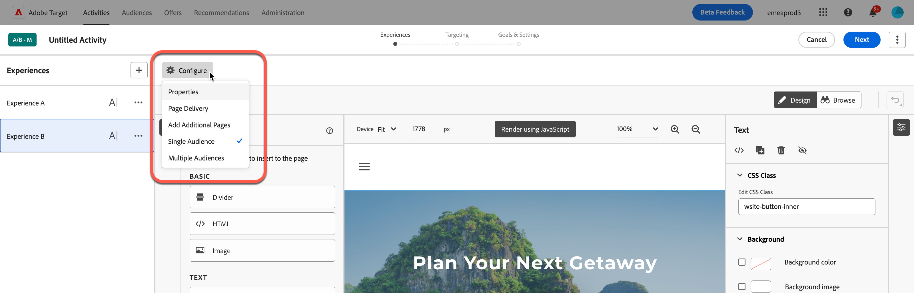
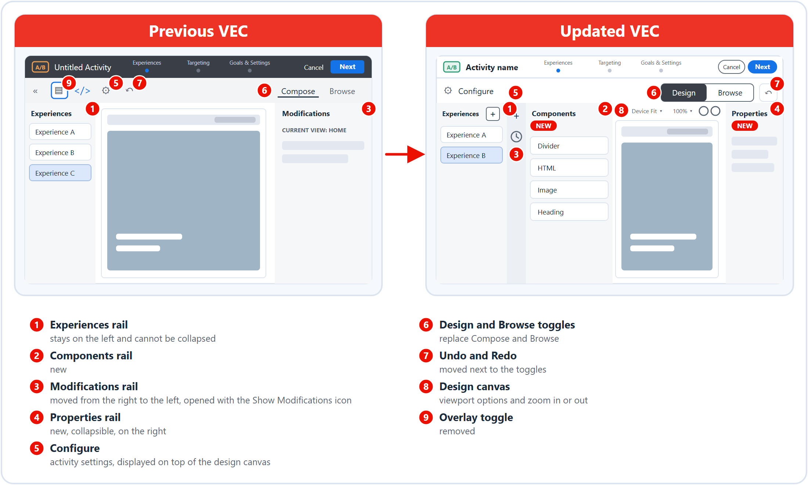

# [!UICONTROL 시각적 경험 작성기] 변경 사항 {#vec-changes}

>[!BEGINSHADEBOX]

**이 페이지에서:** [!DNL Adobe Target Standard/Premium] 25.2.1 릴리스에 도입된 업데이트된 [!UICONTROL 시각적 경험 작성기]&#x200B;(VEC)가 이전 버전과 어떻게 다른지 알아봅니다.

>[!ENDSHADEBOX]

[!DNL Adobe Target Standard/Premium] 25.2.1 릴리스(2025년 2월 17일)에서는 업데이트된 [!UICONTROL 시각적 경험 작성기]&#x200B;(VEC)가 도입되었습니다. 이 문서에서는 VEC의 이전 버전과 업데이트된 버전의 차이점에 대해 설명합니다.

>[!IMPORTANT]
>
>업데이트된 [!UICONTROL 시각적 경험 작성기]에는 [!DNL Chrome Web Store]에서 사용할 수 있는 [!DNL Adobe Experience Cloud] [**[!UICONTROL 시각적 편집 도우미&#x200B;]**확장](/help/main/c-experiences/c-visual-experience-composer/r-troubleshoot-composer/visual-editing-helper-extension.md)이 필요합니다.

VEC는 활동이 만들어지거나 기존 활동이 편집될 때 표시됩니다.

## VEC에 대한 주요 변경 사항

다음 섹션에서는 이전 버전과 비교하여 업데이트된 VEC의 주요 변경 사항에 대해 설명합니다.

### [!UICONTROL 경험] 레일

이전 버전과 마찬가지로 **[!UICONTROL 경험]** 레일은 VEC 왼쪽에 남아 있습니다. **[!UICONTROL 경험]** 레일을 축소할 수 없습니다.

**[!UICONTROL 경험]** 레일을 사용하여 경험을 만들거나 이름을 바꾸거나 제거합니다.

새 경험을 추가하려면 **[!UICONTROL 추가]** 아이콘( )을 클릭하십시오. 경험을 복제, 삭제 또는 리디렉션하려면 **[!UICONTROL 추가 작업]** 아이콘()을 클릭하십시오.

### [!UICONTROL 구성 요소] 레일(신규)

새 **[!UICONTROL 구성 요소]** 레일은 웹 페이지에 여러 구성 요소를 추가하고 필요에 따라 편집할 수 있습니다.

새 구성 요소를 추가하려면 **[!UICONTROL 구성 요소]** 레일에서 원하는 구성 요소를 선택하고 페이지의 기존 요소를 마우스로 가리킨 다음 선택한 요소 앞 또는 뒤에 구성 요소를 삽입하도록 선택합니다.

**[!UICONTROL 구성 요소]** 레일 대신 **[!UICONTROL 수정 사항]** 레일이 이 영역에 표시되면 **[!UICONTROL 구성 요소 표시]** 아이콘()을 클릭합니다. **[!UICONTROL 구성 요소 표시]** 아이콘( )과 **[!UICONTROL 수정 사항 표시]** 아이콘( )은 적절한 옵션을 표시하는 토글 역할을 합니다.

**[!UICONTROL 구성 요소]** 레일이 열려 있는 동안 **[!UICONTROL 구성 요소]** 레일을 축소하고 **[!UICONTROL 디자인]** 캔버스를 확대하려면 ( ) 아이콘을 클릭합니다.

### [!UICONTROL 수정] 레일

**[!UICONTROL 수정 사항]** 레일을 열려면 **[!UICONTROL 구성 요소]** 레일에서 **[!UICONTROL 수정 사항 표시]** 아이콘()을 클릭합니다. **[!UICONTROL 수정 사항]** 레일이 편집 캔버스의 오른쪽에서 왼쪽으로 위치가 변경되었습니다.

>[!NOTE]
>
>**[!UICONTROL 수정 사항]** 레일이 열려 있는 동안 **[!UICONTROL 수정 사항]** 레일을 축소하고 **[!UICONTROL 디자인]** 캔버스를 확대하려면 **[!UICONTROL 수정 사항 표시]** 아이콘( )을 클릭합니다.

**[!UICONTROL 수정 사항]** 레일은 VEC에서 페이지에 적용된 모든 변경 사항을 보여주며 추가 변경(예: CSS 선택기, Mbox 및 사용자 지정 코드)을 허용합니다.

수정 사항을 추가하거나, 모든 수정 사항을 삭제하거나, 모든 잘못된 수정 사항을 삭제하려면 **[!UICONTROL 추가 옵션]** 아이콘()을 클릭하십시오. 일괄 작업을 수행하려면 **[!UICONTROL 선택]**&#x200B;을 클릭하세요. **[!UICONTROL 모든 페이지에 적용]** 또는 **[!UICONTROL 삭제]**.

**[!UICONTROL 수정 사항]** 레일을 다시 표시하려면 **[!UICONTROL 수정 사항]** 레일에서 **[!UICONTROL 수정 사항 숨기기]** 아이콘()을 클릭하십시오.

### [!UICONTROL 속성] 레일(신규)

**[!UICONTROL 속성]** 레일은 페이지에서 선택한 요소의 속성을 변경합니다. 이러한 요소가 HTML 요소이든 [!DNL Target]과(와) 관련된 개체(예: 권장 사항 또는 오퍼)이든.

레일 상단의 아이콘을 클릭하여 HTML 코드를 편집하거나 요소를 삭제, 복제 또는 숨깁니다. 변경 사항이 **[!UICONTROL 수정 사항]** 레일에 표시됩니다.

**[!UICONTROL 속성]** 레일은 오른쪽 레일에서 접을 수 있습니다. **[!UICONTROL 속성]** 레일을 축소하거나 표시하려면 레일의 오른쪽에 있는 **[!UICONTROL 속성 표시/숨기기]** 아이콘()을 클릭하십시오.

### 활동 설정/구성

디자인 캔버스 위에 표시된 **[!UICONTROL 구성]** 아이콘()을 클릭하여 활동 속성 메뉴를 표시합니다.

다양한 옵션은 속성을 할당하고, 페이지 전달 규칙을 편집하고, 사이트 환경 설정을 지정하고, 페이지를 추가하고, 다중 페이지 또는 다중 대상 활동을 활성화하거나 비활성화합니다. **[!UICONTROL 속성]** 할당은 [[!DNL Target Premium]](/help/main/c-intro/intro.md#premium) 기능입니다.

위치 및 기능은 이전 VEC UI와 유사합니다.

### [!UICONTROL 디자인]/[!UICONTROL 찾아보기] 모드

**[!UICONTROL 속성]** 레일의 맨 위에 표시되는 **[!UICONTROL 디자인]**/**[!UICONTROL 찾아보기]** 전환을 사용하여 디자인과 찾아보기 모드를 전환하십시오.

**[!UICONTROL 찾아보기]** 모드를 사용하여 사이트를 탐색하고 업데이트할 보기 또는 페이지를 선택하십시오. 변경 내용을 추가하거나 편집하려면 **[!UICONTROL 디자인]** 모드로 다시 전환하십시오.

### [!UICONTROL 실행 취소]/[!UICONTROL 다시 실행]

**[!UICONTROL 실행 취소]** 아이콘()을 클릭하여 변경 내용을 실행 취소할 수 있습니다.

작업을 다시 실행하려면 **[!UICONTROL 실행 취소]**/**[!UICONTROL 다시 실행]** 단추 그룹을 확장하고 **[!UICONTROL 다시 실행]**&#x200B;을 선택하세요.

### [!UICONTROL 디자인] 캔버스

**[!UICONTROL 디자인]** 캔버스를 통해 화면 맞춤, **[!UICONTROL 데스크톱]**, **[!UICONTROL 태블릿]**, **[!UICONTROL 모바일 가로]** 및 **[!UICONTROL 모바일 세로]**&#x200B;를 포함한 뷰포트를 선택할 수 있습니다.

업데이트된 VEC에서는 적절한 아이콘( 또는 )을 클릭하여 확대 또는 축소를 허용합니다.

## UI 변경 사항을 보여 주는 시각적 일러스트레이션

다음 그림은 업데이트된 VEC에 대한 높은 수준의 UI 변경 사항을 보여줍니다. 그림 왼쪽에는 이전 VEC UI가 표시되고 오른쪽에는 업데이트된 UI가 표시됩니다. 일치하는 숫자는 다양한 요소가 이동되거나 변경된 위치를 보여 줍니다.

{width="800" zoomable="yes"}

## 업데이트된 UI에 대한 추가 정보

* [[!DNL Target Standard/Premium] 25.2.1(2025년 2월 17일) 릴리스 정보](/help/main/r-release-notes/release-notes-for-previous-releases.md#ui-update-2): **[!UICONTROL 활동]**, **[!UICONTROL 권장 사항]** 및 [!UICONTROL 시각적 경험 작성기]&#x200B;(VEC)에 대한 [!DNL Target]의 주요 UI 변경 사항에 대한 요약을 제공합니다.

* [[!DNL Target Standard/Premium] 25.1.1(2025년 1월 9일) 릴리스 정보](/help/main/r-release-notes/release-notes-for-previous-releases.md#ui-update-1): **[!UICONTROL 오퍼 라이브러리]**&#x200B;에 대한 [!DNL Target]의 주요 UI 변경 사항에 대한 요약을 제공합니다.

* [UI 이해 [!DNL Target] UI](/help/main/c-intro/understand-the-target-ui.md): [!DNL Target]에 대한 간략한 개요를 제공하며 자세한 정보와 단계별 지침을 볼 수 있는 링크를 제공합니다.

* [[!UICONTROL 시각적 경험 작성기] 옵션](/help/main/c-experiences/c-visual-experience-composer/viztarget-options.md): 업데이트된 VEC UI 및 해당 옵션에 대해 설명합니다.

* [[!DNL Target] UI 업데이트 FAQ](/help/main/c-intro/updated-ui-faq.md): 탐색 변경, 기능 위치 및 임시 UI 버전 전환 중단 등 새 [!DNL Target] UI 및 [!UICONTROL 시각적 경험 작성기]&#x200B;(VEC)에 대한 일반적인 질문을 해결합니다.
