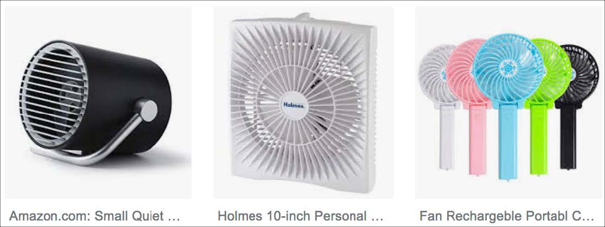

# 프로필 속성 일치 {#profile-attribute-matching}

>[!BEGINSHADEBOX]

**이 페이지에서:** 항목(엔터티)을 방문자의 프로필에 있는 값과 비교하여 [!DNL Adobe Target Recommendations]에서 권장 사항을 동적으로 필터링하는 방법을 알아봅니다.

>[!ENDSHADEBOX]

**[!UICONTROL 프로필 특성 일치]**&#x200B;를 사용하여 크기 또는 즐겨찾기 브랜드와 같이 방문자의 프로필에 저장된 값과 일치하는 권장 사항을 표시합니다. 기준 및 프로모션에 대한 포함 규칙을 만들고 사용하는 프로세스는 사용 사례 및 예와 비슷합니다. 자세한 내용은 [동적 및 정적 포함 규칙 사용](/help/main/c-recommendations/c-algorithms/use-dynamic-and-static-inclusion-rules.md)을 참조하세요.

다음 시나리오는 **[!UICONTROL 프로필 특성 일치]**&#x200B;를 사용하는 방법을 보여 줍니다.

* 안경을 판매하는 한 회사는 방문객이 가장 좋아하는 안경테 색상을 &#39;호두&#39;로 저장한다. 해당 방문자의 경우 &quot;호두&quot;와 색상이 일치하는 안경 프레임만 반환하도록 권장 사항이 설정됩니다.
* 방문자가 회사 웹 사이트를 탐색할 때 방문자의 의류 크기(예: Small, Medium 또는 Large)에 대해 프로필 매개 변수를 정의할 수 있습니다. 해당 프로필 매개 변수와 일치하고 방문자가 선호하는 의류 크기의 제품만 반환하도록 권장 사항을 설정할 수 있습니다.

## 프로필 속성 일치 예

**[!UICONTROL 프로필 특성 일치]**&#x200B;에서는 다음 예제와 같이 방문자 프로필의 특성과 일치하는 항목만 권장합니다.

### 사용자가 선호하는 브랜드의 항목 추천

**[!UICONTROL 프로필 특성 일치]** 옵션을 사용하면 브랜드가 `profile.favoritebrand`에 저장된 값 또는 텍스트와 같은 항목만 추천하는 규칙을 만들 수 있습니다. 이러한 규칙을 사용하면 방문자가 특정 브랜드의 육상용 반바지를 보고 있는 경우 해당 방문자의 즐겨 찾는 브랜드(방문자 프로필의 `profile.favoritebrand`에 저장된 값)와 일치하는 권장 사항만 표시됩니다.


```
Profile Attribute Matching
brand - equals - the value/text stored in - profile.favoritebrand
```

### 구직자에 대한 Job 대응

일자리를 구직자에게 맞추기 위해서는 구직자와 동일한 도시에 있는 일자리만 추천된다. 포함 규칙은 다음 예제와 같이 방문자 프로필에서 Job 목록에 이르기까지 구직자의 위치를 일치시킬 수 있습니다.


```
Profile Attribute Matching
jobCity - equals - the value/text stored in - profile.usersCity
```

### 크기에 따라 항목 추천

다음 예는 프로필 속성 일치가 선풍기를 판매하는 웹 사이트의 권장 사항에 미치는 영향을 보여줍니다.

방문자가 이 웹 사이트에서 다양한 팬 이미지를 클릭하면 각 페이지는 이미지의 팬 크기가 작은지 아니면 큰지 여부에 따라 `entity.size` 매개 변수의 값을 설정합니다. 프로필 스크립트는 `entity.size`의 값이 작은 값과 큰 값으로 설정된 횟수를 추적하고 계산합니다.

그런 다음 방문자가 홈 페이지로 돌아오면 더 많은 작은 팬 또는 큰 팬을 클릭했는지 여부에 따라 필터링된 권장 사항이 표시됩니다.

웹 사이트에서 더 많은 작은 팬을 보는 것을 기반으로 하는 추천:



웹 사이트에서 더 많은 대형 팬을 보는 것을 기반으로 하는 추천:


