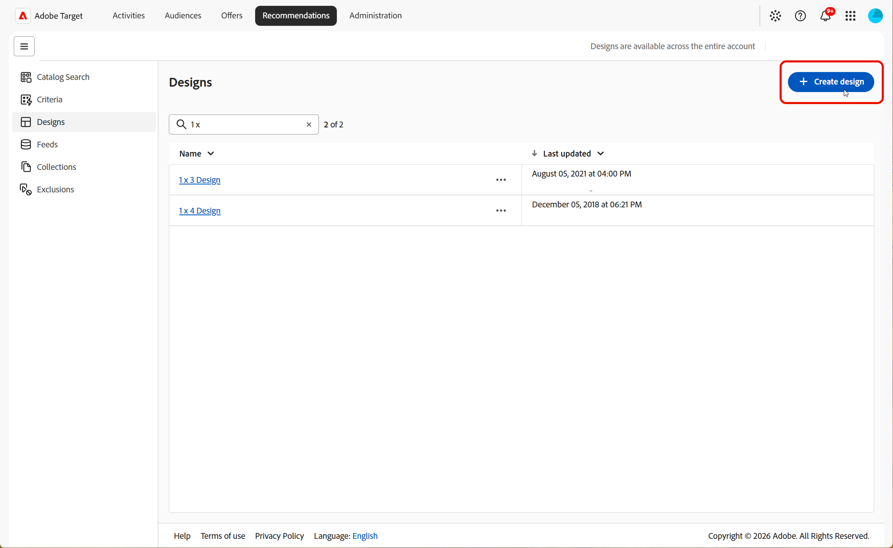
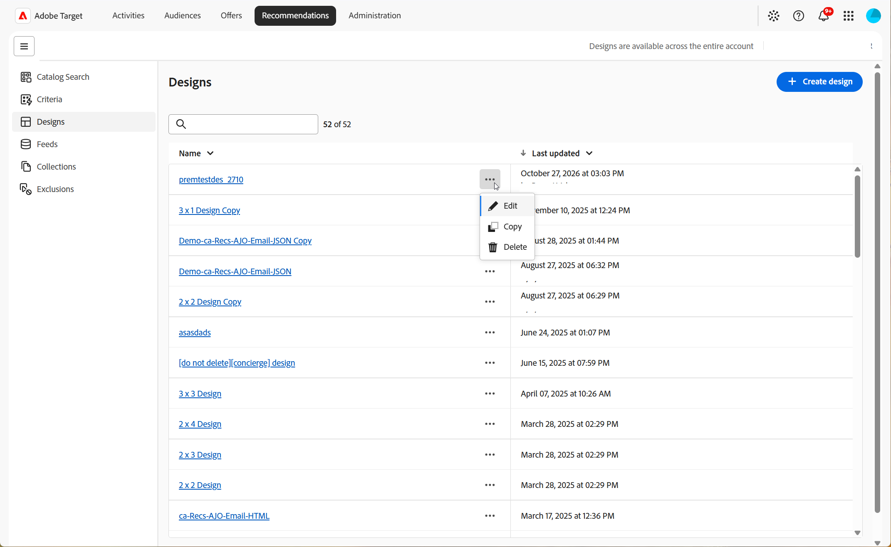
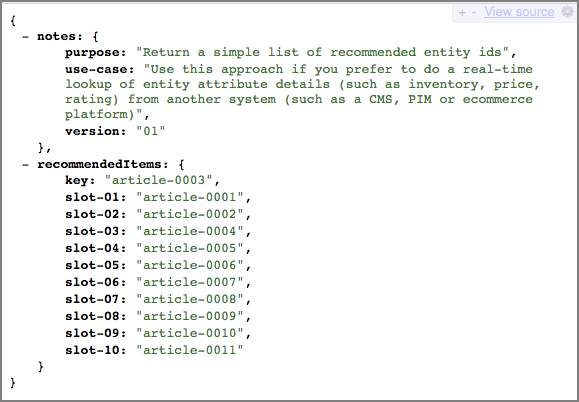

# 디자인 만들기 {#create-design}

>[!BEGINSHADEBOX]

**이 페이지에서:** [!DNL Adobe Target Recommendations]에서 디자인을 만들고, 편집하고, 복사하고, 삭제하는 방법과 권장 사항을 JSON으로 반환하는 방법을 알아봅니다.

>[!ENDSHADEBOX]

디자인은 페이지에 권장 사항이 어떻게 나타나는지를 정의합니다. 디자인은 기본 디자인을 기반으로 하거나 사용자 지정 디자인으로 만들 수 있습니다. **[!UICONTROL 권장 사항]** > **[!UICONTROL 디자인]** 화면에 기본 디자인 카드와 계정에서 만든 디자인이 모두 표시됩니다.

* 기본 디자인은 편집하거나 삭제할 수 없습니다.
* 사용자 지정 디자인은 편집, 복사 또는 삭제할 수 있습니다.
* 기본 디자인을 기반으로 디자인을 만들려면 먼저 디자인을 복사한 다음 복사본을 편집합니다.

디자인은 활동 만들기 프로세스 동안 **[!UICONTROL VEC(시각적 경험 작성기]**) 내에서 또는 활동 만들기 외부의 디자인 라이브러리에서 만들 수 있습니다. 다음 단계에서는 디자인이 라이브러리에서 생성된다고 가정하지만 단계는 유사합니다.

## 라이브러리에서 디자인 만들기 {#steps}

1. **[!UICONTROL 권장 사항]** > **[!UICONTROL 디자인]**&#x200B;을 클릭하여 **[!UICONTROL 디자인]** 라이브러리를 표시합니다.

1. 다음 방법 중 하나로 디자인을 시작합니다.

   * 기본 디자인 또는 기존 디자인을 기반으로 디자인을 만들려면 해당 디자인에 대해 추가 작업 아이콘()을 클릭한 다음 **[!UICONTROL 복사]**&#x200B;를 클릭합니다. **[!UICONTROL 디자인 만들기]** 대화 상자가 표시됩니다. 편집된 복사본은 새로운 사용자 정의 디자인이 됩니다.
   * 사용자 지정 디자인을 처음부터 만들려면 **[!UICONTROL 디자인 만들기]**&#x200B;를 클릭하세요.

     

1. **[!UICONTROL 이름]**&#x200B;을(를) 입력하고 디자인 카드에 표시할 선택적 미리 보기 이미지를 선택하십시오.

   기본 디자인을 사용하면 디자인 이름 다음에 &quot;복사&quot;가 **[!UICONTROL 콘텐츠 이름]** 필드에 나타납니다. 이름을 편집할 수 있습니다.

1. (조건부) 원하는 대로 디자인 **[!UICONTROL 코드]**&#x200B;를 편집합니다.

   권장 디자인은 오픈 소스 Velocity 디자인 언어를 사용합니다. Velocity에 대한 자세한 내용은 [https://velocity.apache.org](https://velocity.apache.org) 및 [Velocity를 사용하여 디자인 사용자 지정](/help/main/c-recommendations/c-design-overview/customizing-a-template.md)을 참조하십시오.

   디자인은 HTML 또는 비 HTML일 수 있습니다. 기본적으로 HTML 디자인은 웹 환경에서 클릭 추적을 허용하기 위해 `<div>` 태그로 줄바꿈됩니다. 비 HTML 디자인은 클릭 추적이 불가능한 웹이 아닌 환경을 위한 것입니다. HTML 이외의 코드를 사용하려면 **[!UICONTROL HTML 디자인]** 토글을 &quot;끄기&quot; 위치로 밉니다.

   >[!NOTE]
   >
   >하드 코딩되거나 루프를 통해 디자인에서 참조할 수 있는 최대 개체 수는 99개입니다.

1. **[!UICONTROL 만들기]**&#x200B;를 클릭합니다.

1. 디자인 편집, 복사 또는 삭제에 대한 추가 작업 아이콘()을 클릭한 다음 적절한 옵션(**[!UICONTROL 편집]**, **[!UICONTROL 복사]** 또는 **[!UICONTROL 삭제]**)을 클릭합니다.

   

디자인은 전체 계정에서 사용할 수 있습니다. 디자인을 삭제하기 전에 계정 간 사용을 고려해야 합니다. 삭제된 디자인을 복구할 수 없습니다.

## JSON 예 {#json-example}

다음 예제에서는 활동이 [양식 기반 편집기](/help/main/c-experiences/form-experience-composer.md)로 구성된 경우 JSON 응답을 반환하는 방법을 보여 줍니다.

1. **[!UICONTROL 디자인 라이브러리]** 또는 양식 기반 워크플로에서 디자인을 만듭니다. **[!UICONTROL VEC(시각적 경험 작성기]**) 워크플로 내에서 만들어진 디자인은 클릭 추적을 위해 `<div>`에 래핑된 HTML 디자인만 될 수 있습니다.

1. **[!UICONTROL HTML 디자인]** 옵션이 꺼져 있는지 확인합니다.

   

1. 다음 예제와 같은 코드를 디자인에 붙여넣습니다.

   +++ 엔티티 ID 목록을 반환하는 샘플 디자인 코드

   ```javascript
       #* 
       * "Return a simple list of recommended entity ids"   
       *#
   
       {   
         "notes":{   
         "purpose": "Return a simple list of recommended entity ids",   
         "use-case": "Use this approach if you prefer to do a real-time lookup of entity attribute details (such as inventory, price, rating) from another system (such as a CMS, PIM or ecommerce platform)",   
         "version": "01"   
         },   
         "recommendedItems": {   
           "key": "$key.id",   
           "slot-01": "$entity1.id",   
           "slot-02": "$entity2.id",   
           "slot-03": "$entity3.id",   
           "slot-04": "$entity4.id",   
           "slot-05": "$entity5.id",   
           "slot-06": "$entity6.id",   
           "slot-07": "$entity7.id",   
           "slot-08": "$entity8.id",   
           "slot-09": "$entity9.id",   
           "slot-10": "$entity10.id"   
         }   
       }  
   ```

   +++

1. 이 디자인을 사용하는 양식 기반 [!DNL Recommendations] 활동을 설정하십시오.

   +++ 양식 기반 [!DNL Recommendations] 활동을 설정하는 방법 알아보기 

   1. **[!UICONTROL 활동]** 페이지로 이동합니다.
   1. **[!UICONTROL 활동 만들기]** > **[!UICONTROL 권장 사항]**&#x200B;을 클릭합니다.
   1. **[!UICONTROL 경험 작성기 선택]**&#x200B;에서 **[!UICONTROL 양식]**&#x200B;을 선택한 후 **[!UICONTROL 다음]**&#x200B;을 클릭합니다.
   1. 위치 아래에 &quot;Sample_Recs_Response&quot;라는 텍스트를 입력합니다.
   1. **[!UICONTROL 기본 컨텐츠]** 아래에서 아래쪽 화살표를 클릭한 다음 **[!UICONTROL 추천 추가]**&#x200B;를 클릭합니다.
   1. 페이지 유형을 선택합니다. 이 유형은 그 다음 화면의 초기 필터링을 결정합니다.
   1. 기준 카드를 선택한 후, **[!UICONTROL 다음]**&#x200B;을 클릭합니다.
   1. 이전 단계에서 만든 디자인을 선택한 후 **[!UICONTROL 다음]**&#x200B;을 클릭합니다.
   1. 설정 프로세스를 완료합니다.
   1. **[!UICONTROL 비활성]** 옆의 오른쪽 화살표를 클릭한 다음, **[!UICONTROL 활성화]**&#x200B;를 선택합니다.

   +++

1. 활동을 설정하고 활성화한 후 클린 JSON 응답을 가져오기 위한 샘플 요청을 설정할 수 있습니다.

   활동이 저장되는 시점부터 [!DNL Target]은(는) 선택한 기준 구성을 지원하는 모델을 만들어야 합니다. 여러 요인에 따라 이 프로세스는 시간이 걸릴 수 있습니다. 모델이 빌드되면 결과가 나타납니다.

   예:

   ```
   https://[YOUR_CLIENT_CODE].tt.omtrdc.net/m2/YOUR_CLIENT_CODE/ubox/raw?mbox=[YOUR_MBOX_NAME]&mboxContentType=text/html&mboxXDomain=disabled&entity.id=[ENTITY_ID]&mboxHost=rawbox_sample&at_property=[AT_PROPERTY_TOKEN]&mboxNoRedirect=true&mboxPC=1234-4321&mboxSession=9876-7000
   ```

   where

   | 매개 변수 | 값 |
   |--- |--- |
   | `[YOUR_CLIENT_CODE]` | [!DNL Target] 클라이언트 코드(#recsSettings > Recommendations API 토큰 > 클라이언트 코드에서 사용 가능). |
   | `[YOUR_MBOX_NAME]` | 양식 기반 권장 사항 활동의 &quot;위치&quot; 섹션에서 선택한 이름(이 경우 Sample_Recs_Response). |
   | `[ENTITY_ID]` | 카탈로그에 있는 항목의 `entity.id`입니다. |
   | `[AT_PROPERTY_TOKEN]` | (선택 사항) 활동 설정 중에 속성(엔터프라이즈 권한의 일부)을 선택한 경우 추가됩니다. |

알고리즘이 실행되고 결과가 나오면 응답은 다음과 비슷합니다.

{width="575px"}

## 추가 JSON 개체 팁 {#json-tips}

다음 구문을 사용하여 디자인을 설정하여 쉼표로 구분된 간단한 항목 목록을 다시 보낼 수도 있습니다.

```
$entity1.id, $entity2.id, $entity3.id, $entity4.id, $entity5.id, 
```

응답에서 추가 정보를 보낼 수도 있습니다. 다음 코드는 연결된 슬롯(순서)이 있는 엔티티 ID보다 훨씬 더 많은 것을 반환하는 더 복잡한 예입니다. 이 디자인 예는 반환된 항목과 연결된 활동 세부 사항, **[!UICONTROL 대상 프로필]** 세부 사항(해당하는 경우) 및 기타 `entity.attributes`도 반환합니다.

+++ 활동, 프로필 및 엔티티 세부 정보를 반환하는 샘플 디자인 코드

```javascript
  {   
   "adobeRecommendations": {   
    "notes": {   
     "purpose": "Return a list of entity ids with their associated entity.attributes",   
     "use-case": "Use this approach to avoid looking up attribute details after receiving a response from Target",   
     "version": "01"   
    },   
    "recommendedItems": {   
     "slot-01": "$entity1.id",   
     "slot-02": "$entity2.id",   
     "slot-03": "$entity3.id",   
     "slot-04": "$entity4.id",   
     "slot-05": "$entity5.id",   
     "slot-06": "$entity6.id",   
     "slot-07": "$entity7.id",   
     "slot-08": "$entity8.id",   
     "slot-09": "$entity9.id",   
     "slot-10": "$entity10.id"   
    },   
    "activityDetails": {   
     "mbox.name": "email-mbox",   
     "campaign.name": "\${campaign.name}",   
     "campaign.id": "\${campaign.id}",   
     "campaign.recipe.name": "\${campaign.recipe.name}",   
     "campaign.recipe.id": "\${campaign.recipe.id}",   
     "offer.name": "\${offer.name}",   
     "offer.id": "\${offer.id}",   
     "criteria.title": "$criteria.title",   
     "algorithm.name": "$algorithm.name",   
     "algorithm.dayCount": "$algorithm.dayCount"   
    },   
    "visitorProfile": {   
     "profile.favorite-category": "\${profile.favorite-category}",   
     "profile.test": "\${profile.test}",   
     "user.endpoint.lastPurchasedEntity": "\${user.endpoint.lastPurchasedEntity}",   
     "user.endpoint.lastViewedEntity": "\${user.endpoint.lastViewedEntity}",   
     "user.endpoint.mostViewedEntity": "\${user.endpoint.mostViewedEntity}",   
     "user.endpoint.categoryAffinity": "\${user.endpoint.categoryAffinity}",   
     "profile.geolocation.city": "\${profile.geolocation.city}",   
     "profile.geolocation.dma": "\${profile.geolocation.dma}",   
     "profile.geolocation.state": "\${profile.geolocation.state}",   
     "profile.geolocation.country": "\${profile.geolocation.country}",   
     "profile.sessionCount": "\${profile.sessionCount}",   
     "profile.averageDaysBetweenVisits": "\${profile.averageDaysBetweenVisits}",   
     "profile.browserTime": "\${profile.browserTime}",   
     "user.activeActivities": "\${user.activeActivities}",   
     "user.pcId": "\${user.pcId}",   
     "user.isFirstSession": "\${user.isFirstSession}",   
     "user.isNewSession": "\${user.isNewSession}",   
     "user.header": "\${user.header}",   
     "user.parameter": "\${user.parameter}"   
    },   
    "recKey": {   
     "recKeyDetails": {   
      "id": "$key.id",   
      "name": "$key.name",   
      "category": "$key.category",   
      "pageUrl": "$key.pageUrl",   
      "thumbnailUrl": "$key.thumbnailUrl"   
     }   
    },   
    "recDetailedResults": {   
     "recEntity1Details": {   
      "id": "$entity1.id",   
      "name": "$entity1.name",   
      "category": "$entity1.category",   
      "pageUrl": "$entity1.pageUrl",   
      "thumbnailUrl": "$entity1.thumbnailUrl"   
     },   
     "recEntity2Details": {   
      "id": "$entity2.id",   
      "name": "$entity2.name",   
      "category": "$entity2.category",   
      "pageUrl": "$entity2.pageUrl",   
      "thumbnailUrl": "$entity2.thumbnailUrl"   
     },   
     "recEntity3Details": {   
      "id": "$entity3.id",   
      "name": "$entity3.name",   
      "category": "$entity3.category",   
      "pageUrl": "$entity3.pageUrl",   
      "thumbnailUrl": "$entity3.thumbnailUrl"   
     },   
     "recEntity4Details": {   
      "id": "$entity4.id",   
      "name": "$entity4.name",   
      "category": "$entity4.category",   
      "pageUrl": "$entity4.pageUrl",   
      "thumbnailUrl": "$entity4.thumbnailUrl"   
     },   
     "recEntity5Details": {   
      "id": "$entity5.id",   
      "name": "$entity5.name",   
      "category": "$entity5.category",   
      "pageUrl": "$entity5.pageUrl",   
      "thumbnailUrl": "$entity5.thumbnailUrl"   
     },   
     "recEntity6Details": {   
      "id": "$entity6.id",   
      "name": "$entity6.name",   
      "category": "$entity6.category",   
      "pageUrl": "$entity6.pageUrl",   
      "thumbnailUrl": "$entity6.thumbnailUrl"   
     },   
     "recEntity7Details": {   
      "id": "$entity7.id",   
      "name": "$entity7.name",   
      "category": "$entity7.category",   
      "pageUrl": "$entity7.pageUrl",   
      "thumbnailUrl": "$entity7.thumbnailUrl"   
     },   
     "recEntity8Details": {   
      "id": "$entity8.id",   
      "name": "$entity8.name",   
      "category": "$entity8.category",   
      "pageUrl": "$entity8.pageUrl",   
      "thumbnailUrl": "$entity8.thumbnailUrl"   
     },   
     "recEntity9Details": {   
      "id": "$entity9.id",   
      "name": "$entity9.name",   
      "category": "$entity9.category",   
      "pageUrl": "$entity9.pageUrl",   
      "thumbnailUrl": "$entity9.thumbnailUrl"   
     },   
     "recEntity10Details": {   
      "id": "$entity10.id",   
      "name": "$entity10.name",   
      "category": "$entity10.category",   
      "pageUrl": "$entity10.pageUrl",   
      "thumbnailUrl": "$entity10.thumbnailUrl"   
     }   
    }   
   }   
  }  
```

+++

