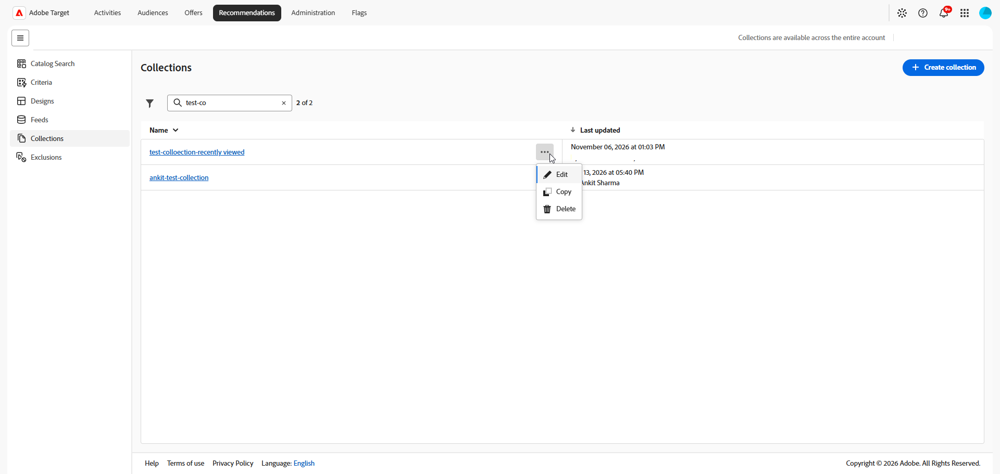

# 컬렉션 {#collections}

>[!BEGINSHADEBOX]

**이 페이지에서:** [!DNL Adobe Target Recommendations]에서 항목의 컬렉션을 만들고 관리하고 사용하는 방법을 알아보세요.

>[!ENDSHADEBOX]

컬렉션은 권장 사항에 적합한 제품 또는 항목 세트입니다. 컬렉션은 항목이 해당 컬렉션의 일부가 되기 위해 충족해야 하는 조건으로 정의됩니다. 유사 또는 관련 항목, 특정 가격 범위나 색상 또는 특정 지역에서 관심을 가질 수 있는 항목 등 비즈니스에 의미가 있는 모든 방식으로 항목을 그룹화할 수 있습니다.

컬렉션은 제품을 논리 버킷으로 구성합니다. 예를 들어 일부 항목을 한 지역에서는 사용할 수 있지만 다른 지역에서는 사용할 수 없는 경우 컬렉션은 방문자의 영역에서 사용할 수 없는 항목을 제외할 수 있습니다. 컬렉션은 계절별 항목 또는 비즈니스에 적용되는 기타 조직 매개 변수를 구성할 수도 있습니다. 항목을 카탈로그로 그룹화한 다음 각 컬렉션에 대해 별도의 권장 사항을 만들 수 있습니다.

다음은 컬렉션이 나머지 [!DNL Recommendations]과(와) 상호 작용하는 방식에 대해 설명합니다.

* 각 기준에 대해 생성된 [백업 권장 사항](/help/main/c-recommendations/c-algorithms/backup-recs.md)도 컬렉션을 사용하므로 컬렉션에 있는 항목만 백업 권장 사항에 포함됩니다. 따라서 위치에 맞는 제품만 표시됩니다.
* 컬렉션은 각 기준이 실행될 때마다 재구성 또는 업데이트됩니다.
* 컬렉션 규칙은 기준 실행 후 생성된 권장 사항 항목에 적용됩니다. 이는 출력에서 ER(엔티티 권장 사항)에만 영향을 주고 키에는 영향을 주지 않습니다.
* 컬렉션은 **[!UICONTROL 최근에 본 항목]** 추천 키를 사용할 때는 적용되지 않습니다.
* 포함 기준은 유사한 결과를 생성할 수 있지만 활동이 생성될 때마다 설정되어야 합니다. 컬렉션이 한 번 만들어지면 다시 설정하지 않고도 재사용할 수 있습니다.
* [!DNL Recommendations] 활동을 만들거나 편집할 때 활동 다이어그램의 **[!UICONTROL 기준]** 레이블 옆에 컬렉션 이름이 표시됩니다.

## 컬렉션 만들기 {#task_1256DFF6842141FCAADD9E1428EF7F08}

컬렉션은 전체 계정에서 사용할 수 있으므로 [!DNL Recommendations] 활동에서 한 번 만들어진 컬렉션을 선택할 수 있습니다. 규칙은 컬렉션에 정의되어 있으므로 각 활동에 대해 다시 설정할 필요가 없습니다.

1. 기존 컬렉션 목록을 표시하려면 **[!UICONTROL 권장 사항]** > **[!UICONTROL 컬렉션]**&#x200B;을 클릭합니다.

   기존 컬렉션을 편집, 복사 또는 삭제하려면 컬렉션 옆에 있는 추가 작업 아이콘( )을 클릭한 다음 원하는 옵션을 클릭합니다.

   >[!NOTE]
   >
   >**[!UICONTROL 컬렉션]** 목록 보기의 각 컬렉션에 대해 보고된 &quot;항목 수&quot;는 구성된 기본 권장 사항 [호스트 그룹](/help/main/administrating-target/hosts.md)(환경)에서 해당 컬렉션에 대한 규칙과 일치하는 제품의 수입니다. 기본 호스트 그룹을 변경하려면 [설정](https://experienceleague.adobe.com/docs/target-dev/developer/recommendations.html){target=_blank}을 참조하십시오.

1. **[!UICONTROL 컬렉션 만들기]**&#x200B;를 클릭합니다.

   

1. 컬렉션에 대한 **[!UICONTROL 이름]**&#x200B;을(를) 입력하십시오. 선택적 **[!UICONTROL 설명]**&#x200B;도 입력할 수 있습니다.

1. (조건부) **[!UICONTROL 환경]** 필터에서 [환경](/help/main/administrating-target/environments.md)을(를) 선택하여 해당 환경에서 컬렉션의 내용을 미리 봅니다. 기본적으로 기본 호스트 그룹의 결과가 표시됩니다.

1. 컬렉션을 만드는 데 사용되는 규칙을 설정합니다.

   컬렉션은 제품 ID, 카테고리, 여백 또는 목록의 다른 매개 변수를 중심으로 빌드될 수 있습니다. 여러 매개 변수를 사용하여 컬렉션을 정의하는 규칙을 추가합니다. 여러 규칙이 AND 연산자로 결합되므로 컬렉션을 적용하려면 지정된 모든 규칙이 일치해야 합니다.

1. **[!UICONTROL 만들기]**&#x200B;를 클릭합니다.

1. 컬렉션이 만들어지면 추가 작업 아이콘()을 클릭하고 적절한 옵션을 선택합니다. **[!UICONTROL 편집]**, **[!UICONTROL 복사]** 또는 **[!UICONTROL 삭제]**.

   

<!--
## Create a collection using [!UICONTROL Advanced Search]

You can also create collections using [!UICONTROL Advanced Search] on the [Catalog Search](/help/main/c-recommendations/c-products/catalog-search.md#save-as) page ([!UICONTROL Recommendations] > [!UICONTROL Catalog Search] > [!UICONTROL Advanced Search]). 

After creating a search using "id > contains," for example, you can then click [!UICONTROL Save As] > [!UICONTROL Collection].

>[!IMPORTANT]
>
>The [!UICONTROL Advanced Search] functionality is case-insensitive; however, products returned at the time of delivery are based on case-sensitive search. This mismatch might lead to confusion. Ensure that you consider case-sensitivity when you create collections based on results using the [!UICONTROL Advanced Search] functionality. For example, if you perform a search for "Holiday," that initial search lists results containing "Holiday" and "holiday." If you then create a catalog with the intent to return products containing "holiday," only products containing "holiday" are returned. Products containing "Holiday" are not returned.
-->

## 활동에서 컬렉션 사용 {#use-collection}

[!DNL Recommendations] 활동의 각 경험에 대해 컬렉션이 선택됩니다. 컬렉션은 해당 경험의 권장 사항에 표시할 수 있는 항목을 결정합니다.

1. [컬렉션 만들기](#task_1256DFF6842141FCAADD9E1428EF7F08).

   

1. **[!UICONTROL 활동]** 및 [새 권장 사항 활동 만들기](/help/main/c-recommendations/t-create-recs-activity/create-recs-activity.md)를 클릭하거나 기존 활동을 편집합니다.

   

1. 기준 및 디자인을 선택한 후 **[!UICONTROL 옵션]** 페이지에서 원하는 컬렉션을 선택하십시오.

1. (조건부) 기존 활동의 컬렉션을 변경하려면 **[!UICONTROL 경험]** 페이지에서 권장 사항 위치를 클릭하고 **[!UICONTROL 컬렉션 변경]**&#x200B;을 클릭한 다음 원하는 컬렉션을 선택하십시오.
