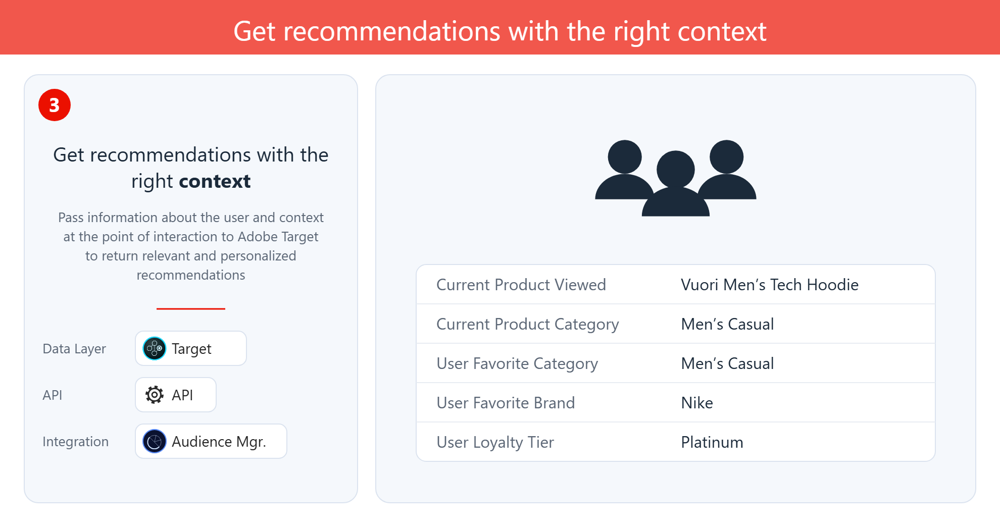
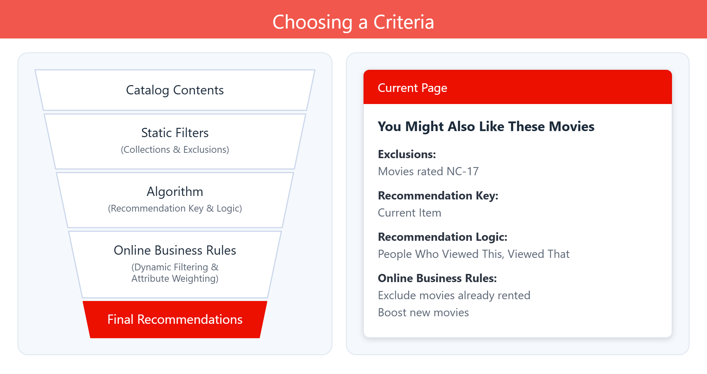
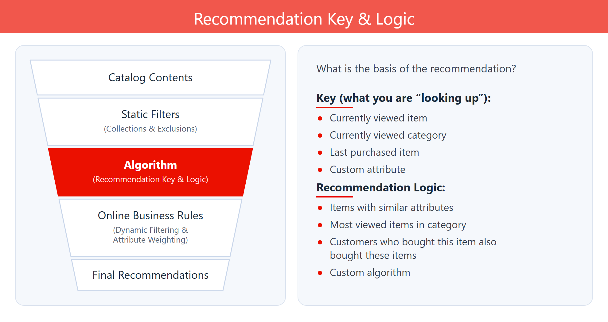
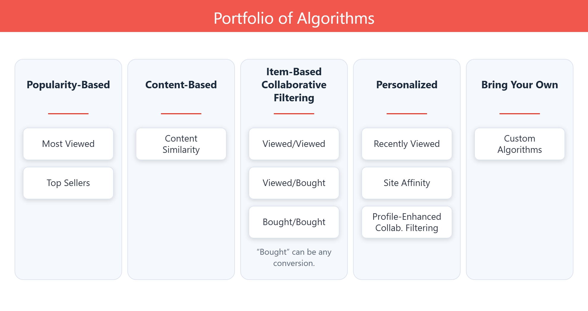
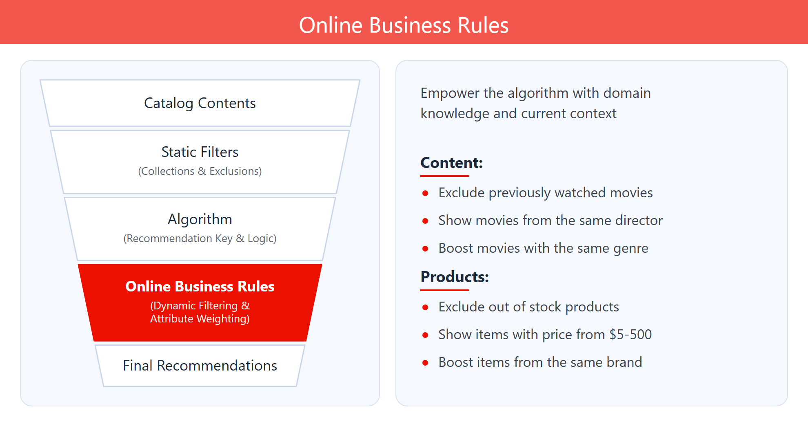

# 추천 소개 {#introduction-to-recommendations}

>[!BEGINSHADEBOX]

**이 페이지에서:** [!DNL Adobe Target]의 [!DNL Recommendations] 활동이 방문자에게 관련 제품 또는 콘텐츠를 표시하는 방법과 [!DNL Recommendations] 구현 및 활동을 계획하고 빌드하는 방법에 대해 알아봅니다.

>[!ENDSHADEBOX]

이 페이지는 *권장 사항 소개* 웨비나를 기반으로 합니다. [!DNL Recommendations] 활동은 이전 방문 횟수에 따라 실시간 제안을 최적화하여 고객의 흥미를 끌 수 있는 제품 또는 콘텐츠를 자동으로 표시합니다. 이 페이지에서는 [!DNL Target] UI에서 [!DNL Recommendations] 활동을 작성하는 방법도 설명합니다.

## 소개

고객은 권장 사항을 점점 더 기대하고 이를 사용 가능한 다른 옵션을 탐색하기 위한 시작점으로 사용합니다. 거의 모든 사람이 매장이나 디지털 에셋 등 추천에서 처음 본 제품을 구입합니다.

사람들이 미디어와 콘텐츠를 소비하는 방식은 점차 개인화된 추천으로 주도되고 있으며 넷플릭스, 스포티파이, YouTube 등 디지털 중심 브랜드는 추천으로 고객 경험을 시작한다. 그 어느 때보다 많은 대안을 사용할 수 있으므로 상호 작용 시점에서 고객과 가장 관련성이 높은 콘텐츠를 식별하는 것이 중요합니다.

마케팅 담당자는 [!DNL Adobe Target] 을 활용하여 다양한 업계, 고객 유형 및 채널에서 개인화된 경험을 제공합니다. 다음 표에는 고객이 [!DNL Target]을(를) 사용하여 개인화된 추천을 제공하는 방법의 몇 가지 예가 나와 있습니다.

| 사용 사례 | 예 |
|---|---|
| 게시 | 웹 게시자는 [!DNL Target Recommendations]을(를) 사용하여 사이트 방문자에게 문서를 추천하고 참여를 유도합니다. |
| 비디오 자습서 | [!DNL Adobe Creative Cloud]은(는) [!DNL Target]을(를) 사용하여 Photoshop 애플리케이션에서 Photoshop 사용자에게 비디오 튜토리얼을 추천합니다. |
| 게이밍 | 게임 회사는 [!DNL Target]을(를) 사용하여 콘솔 내의 사용자에게 게임과 콘텐츠를 추천합니다. |
| B2 판매 | B2B 업체는 [!DNL Target]을(를) 사용하여 B2B 잠재 고객에게 비디오, 백서 및 블로그 게시물을 추천하고 다운로드를 제공하며 기존 고객을 지원합니다. |
| 여행 | 독일 여행 예약자는 [!DNL Target]을(를) 사용하여 호텔 등을 여행객에게 추천합니다. 자세한 내용은 [Adobe Summit 세션](https://2017.summit.adobe.com/na/sessions/summit-online/online-2017/#17608){target=_blank}을 참조하세요. |
| 소매 | 선도적인 B2B retailer은 [!DNL Target]을(를) 사용하여 브라우저와 모바일에서 방문자가 재방문할 수 있는 상위 카테고리와 제품을 추천합니다. |

## 우수한 권장 사항의 요소

우수한 추천은 연관성이 있고 개인화됩니다. 관련성 및 개인화를 촉진하는 세 가지 요소:

* 추천 항목의 관련성을 높이기 위해 **마케터 컨트롤** 마케터는 권장 사항 모델이 고려해야 하는 제품 또는 콘텐츠의 속성을 알고 있습니다. 예를 들어 비디오 사이트에서 사용자는 같은 감독의 영화에는 관심이 있지만 같은 스튜디오의 영화에는 관심이 없을 수 있습니다. [!DNL Target]은(는) 이 도메인 지식을 사용하여 알고리즘을 개선하는 컨트롤을 제공합니다.
* 수백만 개의 카탈로그 항목 및 상호 작용 이벤트를 구분할 수 있는 **정교한 모델**. [!DNL Target]은(는) 10년 이상의 경험을 바탕으로 한 머신 러닝 기능을 갖추고 있으며 매년 수십 억 건의 추천을 처리합니다.
* **사용자 컨텍스트**&#x200B;를 사용하십시오. 예를 들어 추천에는 누군가 방금 시청한 비디오나 누군가가 방금 장바구니에 추가한 셔츠는 포함되지 않아야 합니다. [!DNL Target] 사용자 프로필은 개인화를 보장하기 위해 권장 사항에 사용할 수 있습니다.

## [!DNL Target] 추천 구현

다음 사항을 정의하는 전략으로 시작하십시오.

* **추천할 항목**: 제품, 비디오 또는 콘텐츠.
* **권장 사항 위치**: 채널(웹, 모바일, 매장, 키오스크 등), 고객 여정의 일부 및 권장 사항이 포함된 사이트의 페이지입니다.
* **성공 측정**: 권장 사항이 없는 경험을 권장 사항이 있는 경험과 비교하거나 서로 다른 두 가지 유형의 권장 사항을 비교하여 권장 사항이 성공적인지 여부를 결정하는 방법입니다. 고객 생애 가치에 미치는 영향과 같은 일부 지표는 직접 측정하기 어려우므로 방문당 매출, 평균 주문 가격 또는 클릭 수와 같이 보다 구체적인 지표를 사용하는 것이 더 쉬운 경우가 많습니다. 경우에 따라 지원 호출 수와 같은 지표를 최소화하는 것이 목표입니다.

전략이 정의된 후 [!DNL Target Recommendations]의 구현에는 다음과 같은 세 가지 광범위한 단계가 포함됩니다.

### [!DNL Target]에게 콘텐츠 또는 제품에 대해 교육

[!DNL Recommendations]&#x200B;(으)로 시작하면 추천할 모든 항목에 대한 정보를 전달합니다.

가장 간단하고 자주 사용하는 방법은 제품 정보 관리 시스템 또는 콘텐츠 관리 시스템에서 매일 또는 매주 CSV 파일을 전송하는 것입니다. 다른 옵션은 [!DNL Adobe Target] JavaScript 라이브러리를 사용하여 페이지의 데이터 계층에 정보를 전달하거나, API를 사용하여 소스 시스템에서 직접 정보를 전달하거나, 이미 카탈로그 데이터를 [!DNL Analytics]에 전달하는 경우 [!DNL Adobe Analytics] 통합을 사용하는 것입니다. 예를 들어 CSV 파일을 통해 대부분의 데이터를 매일 전달하고 API를 통해 보다 자주 인벤토리 업데이트를 전달하는 등 여러 옵션을 함께 사용할 수 있습니다. IT 부서는 일반적으로 이 단계 설정에 관여합니다.

어떤 방법을 선택하든 다음 세 가지 범주의 각 항목에 대한 메타데이터를 포함합니다.

* **권장 사항을 받는 사용자에게 표시할 데이터입니다.** 영화 이름, 썸네일 이미지 URL 등이 이에 해당합니다.
* **마케팅 및 머천다이징 컨트롤을 적용하는 데 유용한 데이터** 예를 들어 NC-17 영화를 추천하지 않도록 영화 등급을 지정합니다.
* **항목과 다른 항목의 유사성을 결정하는 데 유용한 데이터입니다.** 예를 들어 영화 장르나 영화 속 배우가 여기에 포함됩니다.

### 사용자 행동 파악

태그를 추가하거나 기존 [!DNL Analytics] 구현을 사용하여 [!DNL Target]에서 사용자가 보고 구매하는 항목을 인식하도록 하십시오. 구매가 컨텍스트와 관련이 없는 경우 PDF 다운로드, 설문 조사 완료, 뉴스레터 가입 또는 비디오 시청 등과 같은 다른 유형의 전환 이벤트를 추적합니다.

[!DNL Target]을(를) 사용하여 사이트에서 A/B 테스트 활동을 실행하는 경우 이 단계를 이미 완료했을 수 있습니다. [!DNL Adobe Analytics]을(를) 사용하여 사이트 방문 횟수 및 전환 동작에 대해 이미 보고하는 경우 [!DNL Analytics]을(를) 동작 데이터 소스로 사용할 수 있습니다. 그렇지 않은 경우 가장 간단한 옵션은 [[!DNL Adobe Experience Platform]](https://experienceleague.adobe.com/docs/target-dev/developer/client-side/at-js-implementation/deploy-at-js/implement-target-using-adobe-launch.html){target=_blank}의 태그와 같은 태그 관리자로 설정하는 것입니다. 실시간 API를 통해 오프라인 또는 인앱 인터랙션을 [!DNL Target]&#x200B;(으)로 보낼 수도 있습니다.

### 상황에 맞는 추천 받기

집계에서 사용자 동작 외에 [!DNL Target]에는 페이지에 대한 정보와 사용자 프로필의 정보를 포함하는 권장 사항이 표시되는 특정 컨텍스트가 필요합니다. [!DNL Target]은(는) 이 정보를 사용하여 항목을 필터링하고 추천의 개인화를 개선합니다.

## 첫 번째 추천 활동 만들기

[!DNL Recommendations] 활동은 대상, 기준 및 디자인을 결합합니다. [!DNL Target]에는 14개의 내장된 대상, 42개의 내장된 기준 및 10개의 내장된 디자인 템플릿이 포함되어 있습니다. 이러한 각 항목을 사용자 정의하거나 직접 추가할 수 있습니다.

[!DNL Target]은(는) 개인화를 위한 레시피와 같은 기준 카드의 개념을 사용합니다. 올바른 기준을 선택하거나 만드는 것은 의도한 개인화 결과를 달성하는 데 중요합니다. 기준 카드는 전체 카탈로그에서 최종 권장 사항 세트로 안내하는 funnel과 같이 작동합니다.

다음 단원에서는 이 funnel의 부분과 [!DNL Target]에서 작동하는 방식에 대해 설명합니다.

### 정적 필터(컬렉션 및 제외)

정적 필터는 자주 변경되지 않을 것으로 예상되는 카탈로그 속성과 관련하여 광범위하게 적용 가능한 규칙이므로 여러 권장 사항에 사용할 수 있습니다.

### 알고리즘(추천 키 및 논리)

다음 단계는 권장 사항의 기반이 되는 권장 사항 키와 논리를 선택하는 것입니다. 추천 키는 추천을 선택하기 위해 &#39;찾아보는&#39; 것입니다.

알고리즘 단계의 

[!DNL Target]에 알고리즘 포트폴리오가 포함되어 있습니다.

### 온라인 비즈니스 규칙

마지막 단계는 온라인 비즈니스 규칙을 적용하는 것입니다. 이 규칙은 방문자가 디지털 속성에 대해 수행하는 작업을 기반으로 도메인 지식과 현재 컨텍스트를 통해 알고리즘을 향상시킵니다.

