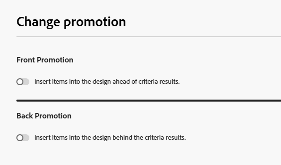

# 프로모션 추가 {#add-promotions}

>[!BEGINSHADEBOX]

**이 페이지에서:** [!DNL Recommendations] 디자인에 판촉된 항목을 추가하는 방법과 정렬 순서를 결정하는 방법을 알아봅니다.

>[!ENDSHADEBOX]

프로모션은 기준에서 권장하는 항목 외에 [!DNL Recommendations] 디자인에 특정 항목을 배치합니다. 설계에서 사용 가능한 슬롯을 사용하며 기준 결과 및 백업 권장 사항보다 우선합니다. 예를 들어 디자인에 6개의 슬롯이 있고 이 중 2개가 프로모션에 사용되는 경우 기준에 따라 권장되는 항목에 대해 4개의 슬롯이 유지됩니다.

프로모션은 활동 기준에서 권장하는 항목에 대해 중복 제거되므로, 주어진 항목이 단일 권장 사항 트레이에 두 번 표시되지 않습니다.

>[!NOTE]
>
>프로모션을 사용하면 CSV 구조 및 출력이 변경됩니다. 이러한 변경 사항은 이메일과 같이 CSV를 포함하는 모든 외부 프로세스에 영향을 줄 수 있습니다.

## 프로모션 추가 {#add-promotion}

프로모션은 프로모션되는 항목, 사용 중인 디자인 슬롯 수 및 표시되는 기간을 정의합니다.

1. **[!UICONTROL 옵션]** 페이지에서 **[!UICONTROL 전면 프로모션]** 또는 **[!UICONTROL 후면 프로모션]** 전환을 클릭합니다.

   다음 그림은 **[!UICONTROL 전면 프로모션]** 전환이 &quot;켜짐&quot; 위치에 있음을 보여줍니다. 기준 결과 전후에 프로모션을 삽입할 수 있습니다.

   

1. 승격된 항목에 사용할 **[!UICONTROL 디자인 슬롯 수]**&#x200B;를 설정하십시오.

   [!DNL Recommendations] 디자인에 따라 최대 20개의 슬롯을 사용할 수 있습니다. 사용되는 각 슬롯은 기준에 따라 반환되는 권장 사항에는 사용할 수 없게 됩니다.

1. 판촉된 항목에 대해 **시작** 날짜 및 **종료** 날짜를 설정하십시오.

   시작 날짜를 설정하지 않으면 프로모션이 즉시 시작됩니다. 종료 날짜가 설정되지 않은 경우 프로모션이 무기한 실행됩니다.

1. **[!UICONTROL 프로모션 유형]** 선택:

   * **[!UICONTROL 항목 목록]**: 홍보할 항목의 `entity.id` 값을 쉼표로 구분하여 입력하십시오.
   * **[!UICONTROL 속성별 승격]**: 승격할 항목의 특성을 정의하는 규칙을 추가합니다. 이 옵션을 사용하면 정적 및 동적 포함 규칙을 통해 동적 일치가 가능합니다. 자세한 정보, 예제 및 사용 사례 시나리오가 필요하면 [동적 및 정적 포함 규칙 사용](/help/main/c-recommendations/c-algorithms/use-dynamic-and-static-inclusion-rules.md#inclusion-rules)을 참조하십시오.
   * **[!UICONTROL 컬렉션 홍보]**: 홍보할 항목 컬렉션을 선택하십시오. 프로모션을 위해 새 컬렉션을 만들 수 있습니다. [컬렉션 만들기](/help/main/c-recommendations/c-products/collections.md#task_1256DFF6842141FCAADD9E1428EF7F08)를 참조하세요.

   프로모션 유형에 따라 프로모션된 항목의 정렬 순서가 결정됩니다. [프로모션 유형 및 정렬 순서](#promotion-sort-order)를 참조하세요.

   

1. **[!UICONTROL 저장]**&#x200B;을 클릭합니다.

활동의 모든 경험에 프로모션이 적용됩니다.

## 프로모션 유형 및 정렬 순서 {#promotion-sort-order}

판촉된 항목의 정렬 순서는 다음 표와 같이 판촉 유형에 따라 다릅니다.

| 프로모션 유형 | 기본 정렬 | 백업 정렬 | 동적 필터링 옵션 |
| --- | --- | --- | --- |
| **[!UICONTROL 항목 목록]** | [!DNL Target] UI 또는 API에 입력된 순서 | 무작위(UI 또는 API를 통해 선택한 경우) | 아니요 |
| 특성별 **[!UICONTROL 승격]** | `entity.value`(내림차순) | 무작위 지정 없음 | 예 |
| **[!UICONTROL 컬렉션 홍보]** | `entity.value`(내림차순) | 무작위 지정 없음 | 아니요 |

* **[!UICONTROL 항목 목록]**: 기본 정렬 순서는 [!DNL Target] UI 또는 API에 입력된 순서입니다. **[!UICONTROL 항목 순서 무작위 지정]** 확인란은 이 형식에 사용할 수 있습니다. 목록에 프로모션용으로 설정된 슬롯 수보다 많은 항목이 포함된 경우 이 옵션은 디자인에 표시되는 프로모션된 항목을 무작위로 지정합니다. 각 히트에서 [!DNL Target]은(는) 전체 프로모션 집합에서 템플릿의 프로모션에 대해 활성화된 항목을 임의로 선택합니다.
* **[!UICONTROL 속성별 승격]** 및 **[!UICONTROL 컬렉션 승격]**: 기본 순서는 `entity.value` 특성을 기반으로 합니다(내림차순). 순서 무작위 지정은 적용할 수 없습니다.

엔터티에 `entity.value` 특성이 없는 경우(예: 회사에서 제품을 판매하지 않는 경우) 게시 날짜와 같은 숫자 값을 `entity.value` 특성에 전달할 수 있습니다. 그런 다음 홍보된 항목은 가장 최근 게시 날짜까지 내림차순으로 정렬됩니다. `entity.value` 특성은 double 형식이며 문자열을 허용하지 않습니다.
