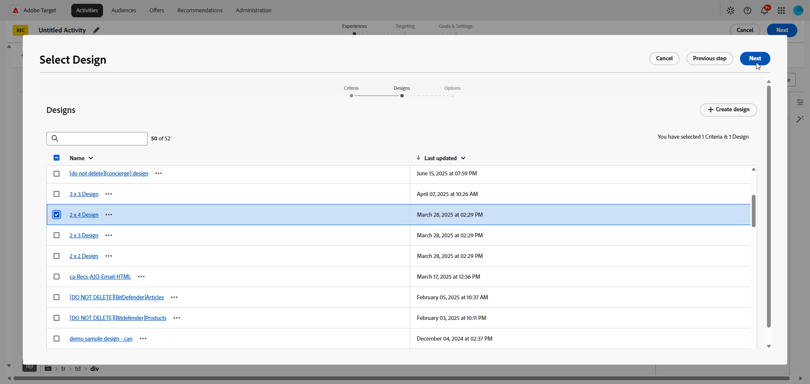
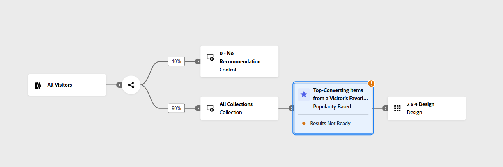

# [!DNL Recommendations] 활동 만들기 {#create-recs-activity}

>[!BEGINSHADEBOX]

**이 페이지에서:** [!DNL Target] **[!UICONTROL 시각적 경험 작성기]**(VEC)에서 위치 선택부터 활동 설정까지 [!DNL Recommendations] 활동을 만드는 방법을 알아봅니다.

>[!ENDSHADEBOX]

[!DNL Recommendations] 활동이 페이지에 권장 항목을 표시합니다. [!DNL Target] **[!UICONTROL 시각적 경험 작성기]**(VEC)에서 활동을 만들면 [!DNL Target]을(를) 사용하는 페이지에 방문자가 볼 수 있는 정확한 위치에 권장 사항을 바로 배치할 수 있습니다.

## 활동을 만들고 위치 선택 {#create-activity}

활동 URL 및 위치는 권장 사항이 표시되는 페이지 및 해당 페이지의 영역을 정의합니다.

1. **[!UICONTROL 활동]** 메뉴에서 **[!UICONTROL 활동 만들기]** > **[!UICONTROL 권장 사항]**&#x200B;을 클릭합니다.

   

1. 필요한 경우 **[!UICONTROL 시각적]**&#x200B;을(를) 선택하십시오.

   대신 **[!UICONTROL 양식 기반 경험 작성기]**&#x200B;를 사용하려면 **[!UICONTROL 양식]**&#x200B;을 선택하세요. [양식 기반 경험 작성기](/help/main/c-experiences/form-experience-composer.md)를 참조하십시오. **[!UICONTROL 단일 페이지 애플리케이션]** VEC를 포함한 작성기 비교를 위해 [경험 및 오퍼](/help/main/c-experiences/experiences.md)를 참조하십시오. VEC 문제에 대해서는 [시각적 경험 작성기 문제 해결](/help/main/c-experiences/c-visual-experience-composer/r-troubleshoot-composer/troubleshoot-composer.md)을 참조하십시오.

1. (조건부) [작업 영역](/help/main/administrating-target/c-user-management/property-channel/property-channel.md)을(를) 선택합니다.

1. 활동 URL을 지정한 다음 **[!UICONTROL 만들기]**&#x200B;를 클릭합니다.

   활동 URL은 권장 사항이 표시되는 페이지입니다. [!DNL Target]은(는) URL 프로토콜([!DNL https] 및 [!DNL http])을 구분하지 않으므로 `http://www.adobe.com`과(와) `https://www.adobe.com`이(가) 모두 일치합니다.

   VEC가 열리고 페이지가 표시됩니다.

1. 권장 사항이 표시되어야 하는 요소를 클릭하고 **[!UICONTROL 콘텐츠 바꾸기]** > **[!UICONTROL 권장 사항]**&#x200B;을 선택합니다.

   <!--
   * **[!UICONTROL Replace w/ Recommendations]**: Deletes the current content of the element and replaces it with the recommendations.
   * **[!UICONTROL Insert Recommendations Before]**: Places the recommendations before the element, above or to the left of it, depending on the page construction.
   * **[!UICONTROL Insert Recommendations After]**: Places the recommendations after the element, below or to the right of it, depending on the page construction.

   

   Use **[!UICONTROL Expand Selection]** to expand the selection to the parent container, so that it includes the desired page elements.
   -->

   권장 사항에 대한 자격이 있는 방문자는 지정된 영역에서 권장 사항을 볼 수 있습니다. 자격이 없는 방문자에게는 기본 콘텐츠가 표시됩니다.

   >[!NOTE]
   >
   >**[!UICONTROL 권장 사항]** 활동은 한 번에 하나의 수정 또는 권장 사항만 지원합니다. 여러 개의 권장 사항을 표시하려면 여러 개의 [!DNL Recommendations] 활동을 만들거나 A/B 또는 XT 테스트를 사용하십시오.

   

<!--
1. Select a page type: Cart Page, Category Page, Home Page, Landing Page, Product Page, Search Results Page, Thank You Page, or Other.

   

   The page type determines which criteria are suggested in the next section.
-->

1. **[!UICONTROL 속성 표시]** 메뉴에 액세스하고 **[!UICONTROL 권장 사항 선택]**&#x200B;을 클릭합니다.

   권장 사항 선택 단추가 있는 시각적 경험 작성기의 

## 기준 선택 {#select-criteria}

기준은 권장되는 항목과 각 방문자에 대해 항목을 선택하는 방법을 결정합니다.

1. 하나 이상의 [기준](/help/main/c-recommendations/c-algorithms/algorithms.md)의 확인란을 선택하십시오.

   

   여러 기준을 선택하면 트래픽이 균등하게 분할되고 각 기준에 대해 백분율을 변경할 수 없습니다. 예를 들어, 두 개의 기준을 선택하고 활동에 기본 콘텐츠가 참여자의 20%에게 표시되면 참여자의 40%가 각 기준의 권장 사항을 확인합니다.

   >[!NOTE]
   >
   >모든 기준이 모든 페이지에서 올바르게 실행되는 것은 아닙니다. 현재 항목 또는 현재 범주 권장 사항이 호환되려면 `entity.id` 또는 `entity.categoryId`에서 페이지나 mbox를 전달해야 합니다. 호환 가능한 기준만 표시하는 것이 가장 좋습니다. 활동에 호환되지 않는 기준을 사용할 수 있도록 하려면 **[!UICONTROL 호환]** 확인란의 선택을 취소하십시오. **[!UICONTROL 관리]** > **[!UICONTROL 권장 사항]** > **[!UICONTROL 호환되지 않는 기준 필터링]** 설정에 따라 이 확인란이 표시되지 않을 수 있습니다. 자세한 내용은 [설정](https://experienceleague.adobe.com/docs/target-dev/developer/recommendations.html){target=_blank}을 참조하십시오.

1. 기준을 찾거나 생성합니다(선택 사항).

   * 목록이 길면 기존 기준을 검색하려면 원하는 기준이 나타날 때까지 검색 필드에 입력합니다. 일부 기준은 [!DNL Recommendations]과(와) 함께 제공되며 팀에서 사용자 지정 기준을 만들 수도 있습니다.
   * 새 기준을 만들려면 **[!UICONTROL 기준 만들기]**&#x200B;를 클릭한 다음 새 기준에 대한 정보를 입력하십시오. [기준 만들기](/help/main/c-recommendations/c-algorithms/create-new-algorithm.md)를 참조하십시오.
   * 기준을 시퀀스로 그룹화하려면 기준 시퀀스를 생성합니다. [기준 시퀀스 만들기](/help/main/c-recommendations/c-algorithms/create-criteria-sequence.md)를 참조하십시오.

1. **[!UICONTROL 다음]**&#x200B;을 클릭합니다.

## 디자인 및 프로모션 선택 {#select-design}

디자인은 선택한 위치에서 권장 사항의 모양을 결정하는 템플릿이고 컬렉션은 표시할 수 있는 항목을 결정합니다. 프로모션을 권장 사항에 추가할 수 있습니다.

1. [디자인](/help/main/c-recommendations/c-design-overview/design-overview.md)을 선택합니다.

   

   * 기존 디자인을 사용하려면 하나 이상의 디자인 확인란을 선택한 다음 **[!UICONTROL 다음]**&#x200B;을 클릭합니다. 여러 기준을 선택한 경우 디자인을 한 개만 선택할 수 있습니다.
   * 사용자 지정 디자인을 만들려면 **[!UICONTROL 디자인 만들기]**&#x200B;를 클릭하고 새 디자인의 이름과 코드를 입력하십시오. **[!UICONTROL 다음]**&#x200B;을 클릭하고 이미지를 선택하거나 업로드한 다음 **[!UICONTROL 완료]** > **[!UICONTROL 완료]**&#x200B;를 클릭합니다.

   [!DNL Target]에는 사전 구성된 디자인이 포함되어 있습니다. 사용자 지정 디자인에 대한 자세한 내용은 [디자인 만들기](/help/main/c-recommendations/c-design-overview/create-design.md#create-design) 및 [Velocity를 사용하여 디자인 사용자 지정](/help/main/c-recommendations/c-design-overview/customizing-a-template.md#customize-design)을 참조하십시오.

1. **[!UICONTROL 다음]**&#x200B;을 클릭합니다.

1. **[!UICONTROL 옵션]** 페이지에서 컬렉션을 선택합니다.

   컬렉션은 권장 사항에 표시할 수 있는 항목을 결정합니다. 컬렉션 만들기 방법 등 자세한 내용은 [활동에서 컬렉션 사용](/help/main/c-recommendations/c-products/collections.md#use-collection)을 참조하세요.

1. (선택 사항) 권장 사항에 전면 및 후면 프로모션을 추가합니다. [프로모션 추가](/help/main/c-recommendations/t-create-recs-activity/adding-promotions.md#add-promotions)를 참조하십시오.

1. **[!UICONTROL 저장]**&#x200B;을 클릭합니다.

   VEC 화면은 페이지에 권장 사항 디자인을 표시합니다.

## 활동 검토 및 완료 {#complete-activity}

저장하기 전에 권장 사항 및 활동 흐름을 검토하면 적합한 대상, 기준 및 디자인이 있는지 확인하는 데 도움이 됩니다.

1. (선택 사항) 활동이 방문자에게 표시되는 방식을 보려면 **[!UICONTROL 미리 보기]**&#x200B;를 클릭합니다. 이 모드에서는 방문자가 권장 사항과 상호 작용하므로 권장 사항과 상호 작용할 수 있습니다. VEC로 돌아가려면 **[!UICONTROL 작성]**&#x200B;을 클릭합니다.

1. 권장 사항을 VEC에서 검토한 후 **[!UICONTROL 다음]**&#x200B;을 클릭합니다.

1. 흐름 다이어그램에서 활동을 검토하고 필요에 맞게 변경합니다. 완료되면 **[!UICONTROL 다음]**&#x200B;을 클릭하세요.

   

   흐름 다이어그램은 활동, 경험 및 성공 지표에 대한 대상을 포함합니다. 다이어그램에서 다음 사항을 변경할 수 있습니다.

   * **대상**: 모든 방문자에게 기본적으로 권장 사항이 표시되지만, 대신 기존 대상을 선택할 수 있습니다. 새 대상을 만드는 대신 [활동 전용 대상](/help/main/c-target/creating-activity-only-audience.md#concept_A6BADCF530ED4AE1852E677FEBE68483)을 만들거나 [여러 대상을 결합](/help/main/c-target/combining-multiple-audiences.md#section_2F1CE9434CC04174B4BA2BFC89B85D77)하여 임시 대상을 만들 수 있습니다.
   * **기준**: 기준을 보거나 컬렉션을 변경합니다(**[!UICONTROL 기준]** 레이블 옆).
   * **컨트롤 그룹**: 컨트롤 환경을 보는 참여자의 비율을 변경합니다. [!DNL Recommendations] 활동에서 컨트롤 그룹에 권장 사항 없는 페이지가 표시됩니다.
   * **디자인**: 디자인 코드를 보거나 디자인을 변경하거나 제거합니다.

1. 활동 설정(예: 이름(필수) 및 목표(선택 사항)를 지정합니다. 활동 이름에 대한 규칙을 포함한 설정에 대해서는 [권장 사항 활동 설정](/help/main/c-recommendations/t-create-recs-activity/recs-activity-settings.md#recs-activity-settings)을 참조하십시오.

1. **[!UICONTROL 저장 및 닫기]**&#x200B;를 클릭합니다.

## 활동 관리 {#manage-activity}

활동이 저장되면 **[!UICONTROL 개요]** 페이지에 활동 요약이 표시됩니다. 이 페이지에서 다음 작업을 사용할 수 있습니다.

* 활동을 활성화, 편집 또는 QA합니다.
* 활동을 Experience Cloud 피드에 공유합니다.
* 경험 URL을 보고 데이터를 다운로드합니다.
* 통제 경험을 보게 되는 활동 참여자의 비율을 변경합니다.
* 기준 세부 사항을 표시하거나 숨기고 디자인 코드를 봅니다.

활동에서 두 개의 추가 페이지를 사용할 수 있습니다.

* **[!UICONTROL 보고서]**: [!DNL Recommendations] 활동의 성능에 대한 보고서를 표시합니다.
* **[!UICONTROL 충돌]**: 발생할 수 있는 [활동 충돌](/help/main/c-experiences/c-visual-experience-composer/activity-collisions.md)을 표시합니다. 충돌은 여러 활동이 동일한 페이지로 콘텐츠를 전달할 때 발생하며, 이로 인해 예상치 못한 콘텐츠가 표시될 수 있습니다.

## 교육 비디오: 권장 사항 활동 만들기(7:15) 

>[!VIDEO](https://video.tv.adobe.com/v/27688)
